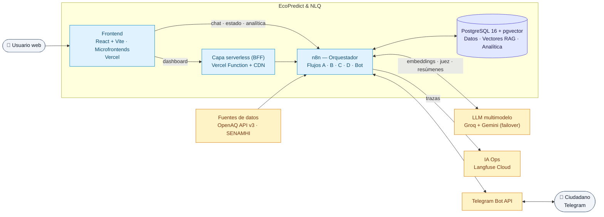
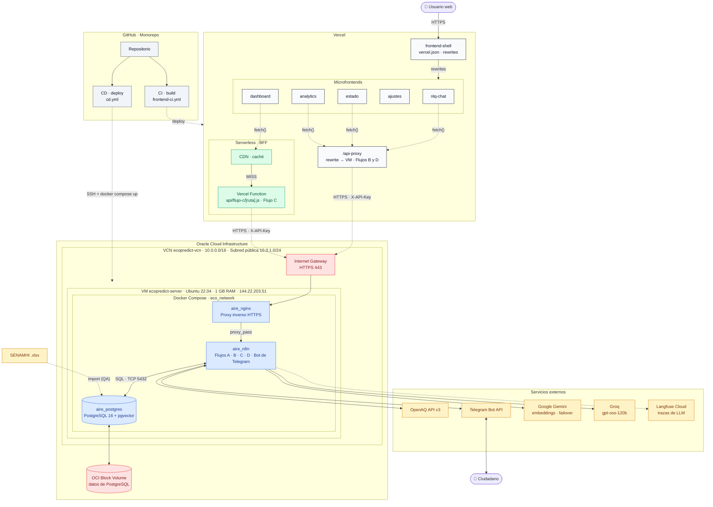
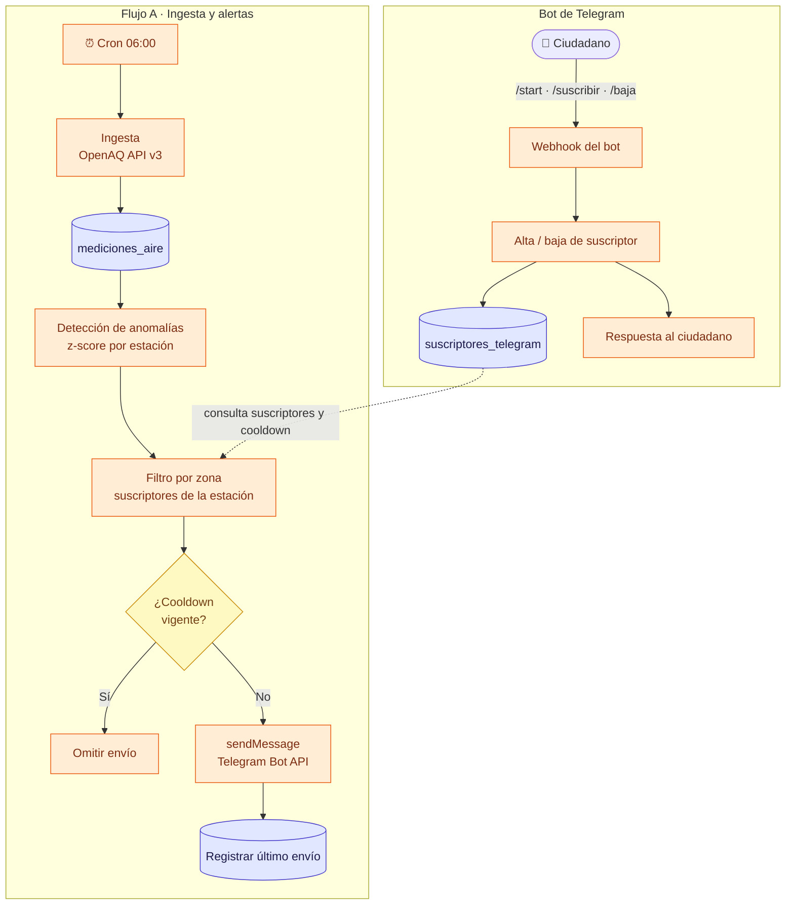
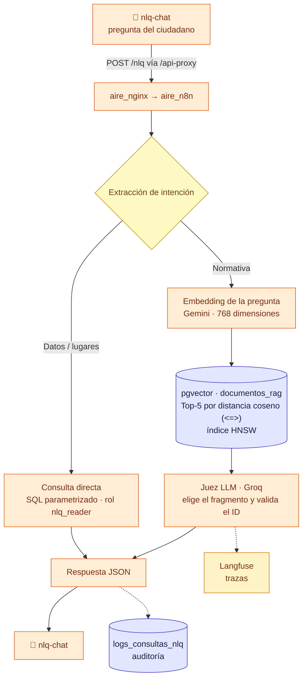
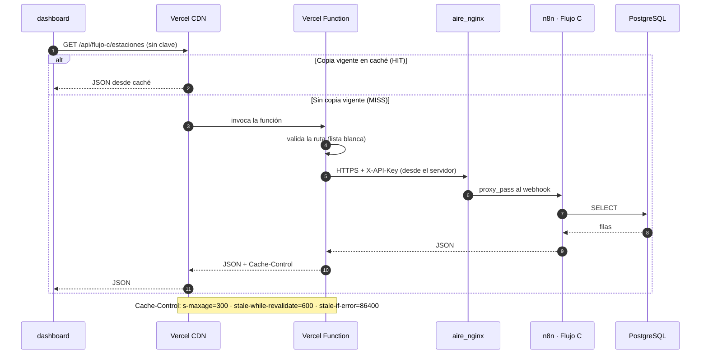
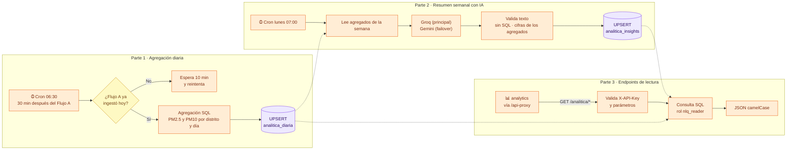

# EcoPredict & NLQ

**Sistema de Alerta e Investigación Ambiental Ciudadana**

EcoPredict & NLQ es un sistema de análisis de la calidad del aire que combina **Open Data, automatización con n8n, Inteligencia Artificial y consultas en lenguaje natural (NLQ)**. Ingesta mediciones ambientales, detecta anomalías, envía alertas por Telegram, responde preguntas ciudadanas con respaldo normativo (RAG) y ofrece analítica histórica por distrito.


---

## Contenido

- [Objetivos](#objetivos)
- [Arquitectura del sistema](#arquitectura-del-sistema)
- [Diagrama de despliegue](#diagrama-de-despliegue)
- [Flujos de orquestación](#flujos-de-orquestación)
- [Microfrontends y rutas](#microfrontends-y-rutas)
- [Endpoints](#endpoints)
- [Base de datos](#base-de-datos)
- [Seguridad](#seguridad)
- [Estructura del repositorio](#estructura-del-repositorio)
- [Uso local](#uso-local)
- [Costos](#costos)
- [Estado](#estado)

---

## Objetivos

- Integrar fuentes de datos ambientales abiertas (OpenAQ y SENAMHI).
- Automatizar la ingesta, el procesamiento y la detección de anomalías.
- Enviar alertas proactivas por Telegram a los ciudadanos suscritos a cada zona.
- Responder consultas en lenguaje natural con IA y respaldo normativo mediante RAG.
- Ofrecer indicadores históricos de calidad del aire por distrito.
- Aplicar buenas prácticas de **DevSecOps**: CI/CD, mínimo privilegio y observabilidad.

---

## Arquitectura del sistema

Vista de contexto: qué hace cada componente y cómo se relacionan.



---

## Diagrama de despliegue

Infraestructura real: frontend en **Vercel**, backend en una VM de **Oracle Cloud Infrastructure (OCI)** con Docker Compose, CI/CD en **GitHub** y servicios externos.



| Capa | Plataforma | Componentes | Responsabilidad |
| --- | --- | --- | --- |
| Presentación | Vercel | `frontend-shell`, 5 microfrontends, `/api-proxy` | Interfaz ciudadana y enrutamiento de solicitudes |
| Serverless (BFF) | Vercel | CDN con caché y Vercel Function | Intermediario seguro y con caché para el Flujo C |
| CI/CD | GitHub | Monorepo, `frontend-ci.yml`, `cd.yml` | Compilación y despliegue automático |
| Cómputo | OCI | `aire_nginx`, `aire_n8n` | Entrada HTTPS y orquestación de flujos |
| Persistencia | OCI | `aire_postgres`, OCI Block Volume | Datos ambientales, vectores, analítica y suscriptores |
| Servicios externos | Nube | OpenAQ, Telegram, Gemini, Groq, Langfuse | Datos, mensajería, IA y observabilidad |

---

## Flujos de orquestación

Todos los flujos se ejecutan en `aire_n8n`. Las llamadas a modelos de lenguaje se registran en **Langfuse** mediante un sub-workflow compartido.

| Flujo | Disparador | Qué hace | Consumidor |
| --- | --- | --- | --- |
| **A** · Ingesta y alertas | Cron 06:00 | Ingesta OpenAQ, detecta anomalías (z-score) y envía alertas por zona | Telegram |
| **Bot de Telegram** | Webhook del bot | Altas y bajas de suscriptores (`/start`, `/suscribir`, `/baja`) | Ciudadano |
| **B** · NLQ con RAG | `POST /nlq` | Responde preguntas en lenguaje natural con respaldo normativo | `nlq-chat`, `estado` |
| **C** · Lectura del dashboard | Webhooks GET | Devuelve estaciones, series horarias y alertas | `dashboard` (vía BFF) |
| **D** · Analítica histórica | Cron 06:30, cron lunes 07:00 y 5 webhooks GET | Agregados diarios, resumen semanal con IA e indicadores por distrito | `analytics` |

### Flujo A · Ingesta y alertas + Bot de Telegram



### Flujo B · Consulta en lenguaje natural con RAG

La rama normativa usa **RAG (Retrieval-Augmented Generation)**: antes de responder, recupera fragmentos reales de la normativa desde `pgvector`, de modo que el modelo no invente normas.



### Flujo C · Lectura del dashboard con capa serverless (BFF)

El dashboard no llama directo a n8n: pasa por una **Vercel Function** que custodia la clave `X-API-Key`, solo acepta rutas de una lista blanca y deja que la **CDN** sirva respuestas en caché, incluso si n8n no está disponible (`stale-if-error`).



### Flujo D · Analítica histórica de calidad del aire

Reutiliza las mediciones que el Flujo A ya guarda (sin volver a consultar OpenAQ ni SENAMHI) y sirve indicadores por distrito al microfrontend **Data Analytics**. Sus tres partes son independientes.



---

## Microfrontends y rutas

| Microfrontend | Proyecto en Vercel | Ruta en el shell | Acceso al backend |
| --- | --- | --- | --- |
| Shell principal | `grupo1-eco-predict-nlq` | `/` | — |
| nlq-chat | `ecopredict-nlq-chat` | `/nlq-chat` | `/api-proxy` → Flujo B |
| estado | `ecopredict-estado-sistema` | `/estado-sistema` | `/api-proxy` → Flujo B |
| analytics | `ecopredict-data-analytics` | `/data-analytics` | `/api-proxy` → Flujo D |
| dashboard | `ecopredict-dashboard-ambiental` | `/dashboard-ambiental` | Vercel Function → Flujo C |
| ajustes | `ecopredict-ajustes` | `/ajustes` | Sin acceso al backend |

---

## Endpoints

| Flujo | Método | Ruta pública | Descripción |
| --- | --- | --- | --- |
| B | `POST` | `/api-proxy/webhook/nlq` | Consulta en lenguaje natural |
| C | `GET` | `/api/flujo-c/estaciones` | Estaciones de monitoreo (vía BFF) |
| C | `GET` | `/api/flujo-c/serie-horaria` | Serie horaria de una estación (vía BFF) |
| C | `GET` | `/api/flujo-c/alertas` | Alertas generadas (vía BFF) |
| D | `GET` | `/analitica/comparativo` | Promedios, variación y tendencia por distrito |
| D | `GET` | `/analitica/ranking-eca` | Distritos ordenados por días sobre el ECA |
| D | `GET` | `/analitica/patron-horario` | Promedio por hora del día |
| D | `GET` | `/analitica/resumen-ia` | Último resumen semanal con IA |
| D | `GET` | `/analitica/distritos` | Distritos con datos y su cobertura |

Las rutas del Flujo D se consumen a través del `/api-proxy`. Todas las llamadas a n8n requieren la cabecera `X-API-Key`.

---

## Base de datos

`aire_postgres` (PostgreSQL 16 + pgvector) · base `calidad_aire`

| Grupo | Tablas principales | Flujo |
| --- | --- | --- |
| Ambientales | `estaciones`, `mediciones_aire`, `ingesta_estado` | A (escribe) · C y D (leen) |
| Alertas | alertas generadas | A |
| Telegram | `suscriptores_telegram` (estación · cooldown) | A y Bot de Telegram |
| NLQ · IA | `logs_consultas_nlq` | B |
| RAG · pgvector | `documentos_rag` (768 dimensiones · índice HNSW) | B |
| Analítica | `analitica_diaria`, `analitica_insights` | D |
| Referencia QA | datos importados de SENAMHI | Calidad de datos |

---

## Seguridad

- **HTTPS extremo a extremo:** el navegador solo habla con su propio dominio en Vercel; el `/api-proxy` y la Vercel Function llegan a la VM por HTTPS a través de `aire_nginx`.
- **Clave en el servidor (BFF):** el dashboard no envía credenciales; la Vercel Function agrega `X-API-Key` desde variables de entorno sin prefijo `VITE_`.
- **Lista blanca de rutas:** la función del Flujo C rechaza con `403` cualquier ruta no autorizada.
- **Mínimo privilegio en la BD:** las consultas del Flujo B y los endpoints del Flujo D usan el rol de solo lectura `nlq_reader`.
- **IA controlada:** el RAG valida el identificador del fragmento elegido y el resumen semanal valida que no contenga SQL ni cifras ajenas a los agregados.
- **Secretos fuera del repositorio:** no se suben archivos `.env` reales.

---

## Estructura del repositorio

```text
Grupo1_EcoPredict-NLQ/
├── .github/
│   ├── PULL_REQUEST_TEMPLATE.md
│   └── workflows/                 # frontend-ci.yml · cd.yml
├── infrastructure/
│   ├── docker-compose.yml
│   ├── docker-compose.production.yml
│   └── .env.example
├── packages/
├── postman/                       # Colecciones de pruebas de endpoints
├── src/
│   ├── frontend-shell/            # Shell principal (Vercel)
│   │   ├── api/flujo-c/[ruta].js  # Vercel Function · BFF del Flujo C
│   │   ├── src/
│   │   └── vercel.json            # rewrites y /api-proxy
│   ├── frontend/                  # Microfrontends
│   ├── n8n-workflows/             # Workflows exportados de n8n
│   ├── database/
│   │   └── migrations/            # Migraciones (incluye 004_flujo_d_analitica.sql)
│   └── ia-ops/                    # Prompts, pruebas y configuración de IA
├── .gitignore
├── LICENSE
└── README.md
```

---

## Uso local

1. Copia las variables de entorno de ejemplo y completa los valores:

   ```bash
   cp infrastructure/.env.example infrastructure/.env
   ```

2. Levanta los servicios del backend (Nginx, n8n y PostgreSQL):

   ```bash
   docker compose -f infrastructure/docker-compose.yml up -d
   ```

3. Instala y ejecuta el frontend shell:

   ```bash
   cd src/frontend-shell
   npm install
   npm run dev
   ```

> No subas archivos `.env` reales. Las variables de producción se configuran en Vercel y en la VM de OCI.

**Variables de entorno principales**

| Variable | Dónde | Uso |
| --- | --- | --- |
| `VITE_N8N_WEBHOOK_URL` | Microfrontends (Vercel) | Ruta del webhook vía `/api-proxy` |
| `VITE_N8N_API_KEY` | Microfrontends (Vercel) | Clave para los flujos que van por `/api-proxy` |
| `N8N_BASE_URL` | Vercel Function | URL base de los webhooks de n8n |
| `N8N_API_KEY` | Vercel Function | Clave de n8n custodiada en el servidor |

---

## Costos

| Proveedor | Plan | Costo |
| --- | --- | --- |
| Vercel | Hobby (6 proyectos + Vercel Function) | PEN 0.00 |
| Oracle Cloud | Always Free | PEN 0.00 |
| **Total asumido por el equipo** | | **PEN 0.00** |

---

## Estado

**Sprint 4 · Implementación e integración.**

- ✅ Ingesta diaria y alertas por zona con cooldown (Flujo A + Bot de Telegram).
- ✅ Consulta en lenguaje natural con RAG y pgvector (Flujo B).
- ✅ Capa serverless BFF con caché para el dashboard (Flujo C · HT-07).
- ✅ Analítica histórica por distrito con resumen semanal con IA (Flujo D).
- ✅ Integración del Flujo D en CI/CD y pruebas de contrato de QA.