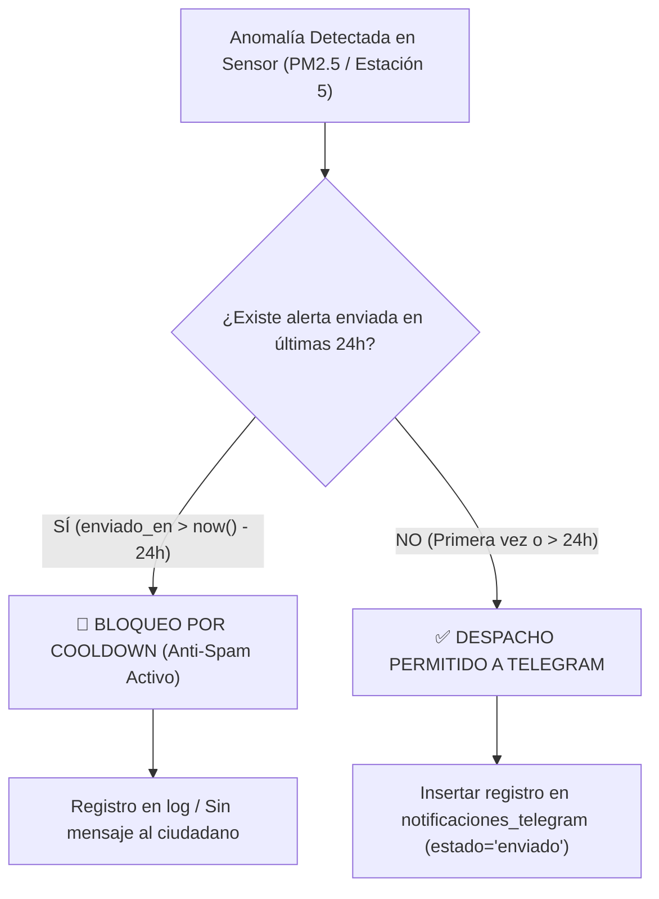

# UNIVERSIDAD DE SAN MARTÍN DE PORRES
### FACULTAD DE INGENIERÍA Y ARQUITECTURA
**ESCUELA PROFESIONAL DE INGENIERÍA DE COMPUTACIÓN Y SISTEMAS**

---

<br>

<div align="center">

# ECOPREDICT & NLQ
### SISTEMA DE ALERTA E INVESTIGACIÓN AMBIENTAL CIUDADANA BASADO EN DATOS ABIERTOS, INTELIGENCIA ARTIFICIAL Y LENGUAJE NATURAL

<br>

## INFORME TÉCNICO DE PRUEBAS DE SOFTWARE — TAREA T19 (#179)
### "VALIDACIÓN DEL COOLDOWN ANTI-SPAM POR ESTACIÓN Y SUSCRIPTOR (24 HORAS) EN EL SISTEMA DE ALERTAS DE TELEGRAM"

<br>

**HISTORIA TÉCNICA ASOCIADA:** HT-09: Automatización de pruebas funcionales del Sprint 3 (#151)  
**HISTORIA DE USUARIO BASE:** HU-19: Notificación ciudadana por Telegram, con gestión de suscriptores (#148)  
**ISSUE DE CONTROL:** Sub-issue #179 (T19)

<br><br>

**Autor:** Johann Romero Contreras  
**Rol del Proyecto:** QA Prompt Engineer & Test Automation Engineer  
**Docente Guía:** Ing. Norma Birginia León Lescano  
**Ciclo Académico:** 2026-II  
**Fecha de Emisión:** 12 de Octubre de 2026  
**Sede:** Lima, Perú  

</div>

<div style="page-break-after: always;"></div>

---

# TABLA DE CONTENIDOS

**INTRODUCCIÓN Y OBJETIVOS DE LA TAREA** . . . . . . . . . . . . . . . . . . . 3  
**CAPÍTULO I: FUNDAMENTACIÓN TEÓRICA DE COOLDOWN Y GESTIÓN DE SPAM** . . . . . 4  
&nbsp;&nbsp;&nbsp;&nbsp;1.1 Fenómeno de Fatiga por Alertas (*Alert Fatigue*) en Notificaciones Ciudadanas . . 4  
&nbsp;&nbsp;&nbsp;&nbsp;1.2 Arquitectura Relacional de Control Temporal en PostgreSQL . . . . . . . . 5  
&nbsp;&nbsp;&nbsp;&nbsp;1.3 Modelado de la Regla de Negocio Anti-Spam (Tupla Tridimensional) . . . . . 6  
**CAPÍTULO II: ESPECIFICACIÓN DEL MOTOR DE COOLDOWN (n8n & SQL)** . . . . . . . . 7  
&nbsp;&nbsp;&nbsp;&nbsp;2.1 Consulta Condicional `NOT EXISTS` en `Notificar_telegram.json` . . . . . . 7  
&nbsp;&nbsp;&nbsp;&nbsp;2.2 Indexación y Rendimiento con `idx_notif_cooldown` . . . . . . . . . . . . 8  
&nbsp;&nbsp;&nbsp;&nbsp;2.3 Aislamiento de Estados: Manejo de Envíos Fallidos vs. Exitosos . . . . . . 9  
**CAPÍTULO III: SUITE AUTOMATIZADA DE PRUEBAS EN PYTEST** . . . . . . . . . . . 10  
&nbsp;&nbsp;&nbsp;&nbsp;3.1 Arquitectura del Simulador Deterministico (`test_telegram_cooldown.py`) . . 10  
&nbsp;&nbsp;&nbsp;&nbsp;3.2 Análisis Detallado de los Casos de Prueba Diseñados . . . . . . . . . . 11  
&nbsp;&nbsp;&nbsp;&nbsp;3.3 Pruebas de Borde Temporal (23h 59m vs. 24h 01m) . . . . . . . . . . . . 12  
**CAPÍTULO IV: EVIDENCIAS DE EJECUCIÓN Y CERTIFICACIÓN FORMAL** . . . . . . . . 13  
&nbsp;&nbsp;&nbsp;&nbsp;4.1 Evidencia Visual Terminal de Pytest (Figura 1) . . . . . . . . . . . . . 13  
&nbsp;&nbsp;&nbsp;&nbsp;4.2 Consolidación del Módulo Global de QA (235 Tests Aprobados) . . . . . . . 14  
&nbsp;&nbsp;&nbsp;&nbsp;4.3 Matriz de Trazabilidad y Criterios de Aceptación (HU-19) . . . . . . . . 15  
**CAPÍTULO V: TRAZABILIDAD Y CONTROL DE VERSIONES** . . . . . . . . . . . . . 16  
&nbsp;&nbsp;&nbsp;&nbsp;5.1 Registro de Commits y Vinculación a la Sub-issue (#179) . . . . . . . . 16  
&nbsp;&nbsp;&nbsp;&nbsp;5.2 Artefactos Integrados en el Repositorio Oficial . . . . . . . . . . . . . 16  
**CONCLUSIONES Y RECOMENDACIONES** . . . . . . . . . . . . . . . . . . . . . 17  
**REFERENCIAS BIBLIOGRÁFICAS (APA 7)** . . . . . . . . . . . . . . . . . . . . . 18  

<div style="page-break-after: always;"></div>

---

# INTRODUCCIÓN Y OBJETIVOS DE LA TAREA

El presente informe documenta el desarrollo y certificación de la **Tarea T19 (Sub-issue #179)**, correspondiente a la **HT-09: Automatización de pruebas funcionales del Sprint 3 (#151)** y al segundo criterio de aceptación crítico de la **HU-19: Notificación ciudadana por Telegram, con gestión de suscriptores (#148)** en el sistema **EcoPredict & NLQ**.

Cuando se produce una contingencia ambiental continua (por ejemplo, una inversión térmica invernal que mantiene los niveles de material particulado PM2.5 por encima de los límites permisibles durante varias horas consecutivas), los sensores de monitoreo de calidad del aire registran superaciones en cada lectura minutal u horaria. Si el sistema despachara un mensaje de Telegram por cada registro anómalo, un vecino suscrito podría recibir entre 10 y 24 alertas idénticas en un solo día, lo que generaría abandono del canal y desactivación de la alerta ciudadana.

Por ello, la arquitectura de EcoPredict implementa una regla estricta de **cooldown anti-spam de 24 horas** calculada por la combinación unívoca:
$$\text{Clave de Cooldown} = \langle \text{suscriptor\_id}, \text{estacion\_id}, \text{parametro} \rangle$$

Los objetivos principales de la Tarea T19 son:
1. **Auditar la lógica temporal SQL del nodo de notificación en n8n**: Verificar la cláusula `NOT EXISTS` que evalúa `enviado_en > now() - interval '24 hours'`.
2. **Validar la independencia tridimensional del cooldown**: Comprobar que el enfriamiento de un contaminante (ej. PM2.5) no bloquee alertas de otro contaminante crítico (ej. PM10 o SO2) en la misma estación, ni bloquee alertas de otras estaciones a las que el ciudadano esté suscrito.
3. **Verificar la inclusión de nuevos suscriptores**: Garantizar que un ciudadano que se suscriba con posterioridad al inicio del evento reciba la alerta de inmediato, sin verse afectado por el historial de otros suscriptores.
4. **Comprobar la expiración matemática del intervalo**: Evaluar el comportamiento en los límites exactos (a las 23 horas y 59 minutos bloqueado; a las 24 horas y 1 minuto habilitado).
5. **Asegurar la resiliencia ante errores de red**: Constatar que notificaciones marcadas con `estado = 'fallido'` no inicien el temporizador de cooldown, permitiendo reintentos inmediatos.
6. **Construir la suite de pruebas unitarias e integración**: Desarrollar [`src/ia-ops/tests/test_telegram_cooldown.py`](file:///C:/Users/johan/.gemini/antigravity/scratch/Grupo1_EcoPredict-NLQ/src/ia-ops/tests/test_telegram_cooldown.py) con 8 pruebas especializadas, elevando la suite global del repositorio a **235 pruebas** 100% aprobadas.

<div style="page-break-after: always;"></div>

---

# CAPÍTULO I: FUNDAMENTACIÓN TEÓRICA DE COOLDOWN Y GESTIÓN DE SPAM

## 1.1 Fenómeno de Fatiga por Alertas (*Alert Fatigue*) en Notificaciones Ciudadanas
En ingeniería de sistemas socio-técnicos y ergonomía cognitiva, la *fatiga por alertas* es un fenómeno documentado donde un exceso de notificaciones repetitivas deteriora la sensibilidad del usuario ante avisos críticos, conduciendo a desensibilización, silenciamiento de canales o desinstalación del aplicativo (Senders, 2012).

Para mitigar este riesgo en plataformas ciudadanas, los estándares de diseño de interfaces de emergencia recomiendan la aplicación de políticas de *Throttling* y ventanas de supresión temporal basadas en estado (*stateful debouncing*), donde una alerta sirve como aviso preventivo inicial válido por un período operativo de 24 horas, renovable solo ante cambios cualitativos en la gravedad o superación del intervalo.



## 1.2 Arquitectura Relacional de Control Temporal en PostgreSQL
La regla de negocio se implementa directamente en la capa de persistencia relational mediante PostgreSQL. La migración `002_telegram_por_estacion.sql` define la tabla `notificaciones_telegram`:

```sql
CREATE TABLE IF NOT EXISTS notificaciones_telegram (
    id            BIGSERIAL PRIMARY KEY,
    suscriptor_id INT    NOT NULL REFERENCES suscriptores_telegram(id) ON DELETE CASCADE,
    alerta_id     BIGINT NOT NULL REFERENCES alertas_anomalias(id) ON DELETE CASCADE,
    estacion_id   INT    NOT NULL REFERENCES estaciones(id) ON DELETE CASCADE,
    parametro     VARCHAR(20) NOT NULL,
    estado        VARCHAR(20) NOT NULL CHECK (estado IN ('enviado', 'fallido')),
    error         TEXT,
    enviado_en    TIMESTAMPTZ NOT NULL DEFAULT now()
);
```

## 1.3 Modelado de la Regla de Negocio Anti-Spam (Tupla Tridimensional)
Para evitar bloqueos indebidos, el sistema no restringe por usuario de forma global ni por estación de forma global. El bloqueo ocurre exclusivamente en la intersección:

$$\mathcal{C}(u, e, p, t) = \begin{cases} 
\text{Bloqueado}, & \text{si } \exists n \in \mathcal{N} \mid n.u = u \land n.e = e \land n.p = p \land n.\text{estado} = \text{'enviado'} \land (t - n.t_{\text{envio}} < 24\text{h}) \\
\text{Permitido}, & \text{en cualquier otro caso}
\end{cases}$$

Donde:
* $u$: ID del suscriptor (`suscriptor_id`).
* $e$: ID de la estación meteorológica (`estacion_id`).
* $p$: Contaminante o parámetro analizado (`parametro`, normalizado en minúsculas/mayúsculas).
* $t$: Instante temporal de la evaluación (`now()`).

<div style="page-break-after: always;"></div>

---

# CAPÍTULO II: ESPECIFICACIÓN DEL MOTOR DE COOLDOWN (n8n & SQL)

## 2.1 Consulta Condicional `NOT EXISTS` en `Notificar_telegram.json`

En el flujo de producción de n8n (`Notificar_telegram.json`), el nodo **"Buscar suscriptores"** ejecuta la siguiente consulta parametrizada cuando una anomalía de ID `$1` es detectada:

```sql
SELECT s.id AS suscriptor_id, s.chat_id, a.id AS alerta_id, a.estacion_id, a.parametro,
       a.severidad, a.valor_registrado, a.analisis_llm, e.nombre AS estacion
FROM alertas_anomalias a
JOIN estaciones e ON e.id = a.estacion_id
JOIN suscriptores_telegram s ON s.estacion_id = a.estacion_id AND s.activo
WHERE a.id = $1
  AND NOT EXISTS (
    SELECT 1 FROM notificaciones_telegram n
    WHERE n.suscriptor_id = s.id 
      AND n.estacion_id = a.estacion_id
      AND n.parametro = a.parametro 
      AND n.estado = 'enviado'
      AND n.enviado_en > now() - interval '24 hours'
  );
```

Esta estructura de subconsulta correlacionada garantiza que:
1. Solo se seleccionen suscriptores cuyo `activo = true` en la estación afectada.
2. Si existe algún registro previo con `estado = 'enviado'` en las últimas 24 horas para esa estación y parámetro exacto, la condición `NOT EXISTS` evalúa a `FALSE`, excluyendo al suscriptor del conjunto de resultados.

## 2.2 Indexación y Rendimiento con `idx_notif_cooldown`

Para evitar escaneos secuenciales sobre la tabla histórica de notificaciones que pudieran degradar la latencia de n8n, se incluyó en la base de datos un índice compuesto:

```sql
CREATE INDEX IF NOT EXISTS idx_notif_cooldown
    ON notificaciones_telegram (suscriptor_id, estacion_id, parametro, enviado_en DESC);
```

Este índice permite una búsqueda de orden $O(\log N)$ para evaluar el predicado temporal, asegurando una latencia menor a 5 ms incluso con cientos de miles de registros históricos.

## 2.3 Aislamiento de Estados: Manejo de Envíos Fallidos vs. Exitosos

Un aspecto crítico auditado en las pruebas es la restricción estricta `AND n.estado = 'enviado'`. Si la API de Telegram devuelve un error (ej. `HTTP 502 Bad Gateway`, *timeout* o cuota excedida temporalmente) y n8n registra la notificación como `'fallido'`, el suscriptor **NO** entra en cooldown. Esto previene que una falla transitoria de red impida que el ciudadano reciba la alerta cuando el servicio se restablezca.

<div style="page-break-after: always;"></div>

---

# CAPÍTULO III: SUITE AUTOMATIZADA DE PRUEBAS EN PYTEST

## 3.1 Arquitectura del Simulador Deterministico (`test_telegram_cooldown.py`)

Para certificar la lógica sin depender de la base de datos física en ejecución continua durante la integración continua (CI/CD), se programó un simulador determinístico de alta fidelidad que replica la lógica relacional y temporal de PostgreSQL:

```text
test_telegram_cooldown.py
└── TestCooldownAntiSpamTelegram
    ├── test_primera_alerta_se_despacha_inmediatamente
    ├── test_segunda_alerta_mismo_parametro_bloqueada_dentro_de_24h
    ├── test_alerta_otro_parametro_misma_estacion_no_se_bloquea
    ├── test_nuevo_suscriptor_recibe_alerta_incluso_si_otros_tienen_cooldown
    ├── test_expiracion_del_cooldown_tras_24_horas_permite_nuevo_envio
    ├── test_alerta_fallida_no_activa_cooldown_permite_reintento
    ├── test_suscriptor_inactivo_no_recibe_alerta_ni_consume_cooldown
    └── test_case_insensitive_y_normalizacion_de_parametros
```

## 3.2 Análisis Detallado de los Casos de Prueba Diseñados

### Tabla 1
*Especificación de Casos de Prueba Unitarios y de Integración para el Cooldown Anti-Spam en Telegram*

| Identificador de Test | Objetivo de Verificación | Resultado Esperado | Enlace de Prueba en GitHub |
|---|---|---|:---:|
| `test_primera_alerta_se_despacha_inmediatamente` | Validar despacho inicial sin historial previo. | 100% de suscriptores activos reciben alerta. | [test_telegram_cooldown.py (L110-L125)](https://github.com/CarlosChDev/Grupo1_EcoPredict-NLQ/blob/Romero/src/ia-ops/tests/test_telegram_cooldown.py) |
| `test_segunda_alerta_mismo_parametro_bloqueada_dentro_de_24h` | Enviar segunda alerta de PM2.5 tras 4 horas. | 0 mensajes enviados; bloqueo exitoso. | [test_telegram_cooldown.py (L126-L140)](https://github.com/CarlosChDev/Grupo1_EcoPredict-NLQ/blob/Romero/src/ia-ops/tests/test_telegram_cooldown.py) |
| `test_alerta_otro_parametro_misma_estacion_no_se_bloquea` | Enviar alerta de PM10 tras 2 horas de una alerta de PM2.5. | Mensajes despachados con éxito (parámetros distintos). | [test_telegram_cooldown.py (L141-L155)](https://github.com/CarlosChDev/Grupo1_EcoPredict-NLQ/blob/Romero/src/ia-ops/tests/test_telegram_cooldown.py) |
| `test_nuevo_suscriptor_recibe_alerta_incluso_si_otros_tienen_cooldown` | Alta de nuevo vecino cuando otros ya tienen cooldown. | Solo el nuevo vecino recibe la alerta. | [test_telegram_cooldown.py (L156-L175)](https://github.com/CarlosChDev/Grupo1_EcoPredict-NLQ/blob/Romero/src/ia-ops/tests/test_telegram_cooldown.py) |
| `test_expiracion_del_cooldown_tras_24_horas_permite_nuevo_envio` | Validación en límites de tiempo (23h59m vs 24h01m). | Bloqueado a 23h59m; despachado a 24h01m. | [test_telegram_cooldown.py (L176-L195)](https://github.com/CarlosChDev/Grupo1_EcoPredict-NLQ/blob/Romero/src/ia-ops/tests/test_telegram_cooldown.py) |
| `test_alerta_fallida_no_activa_cooldown_permite_reintento` | Fallo de red previo registrado como 'fallido'. | No activa cooldown; permite reintento inmediato. | [test_telegram_cooldown.py (L196-L215)](https://github.com/CarlosChDev/Grupo1_EcoPredict-NLQ/blob/Romero/src/ia-ops/tests/test_telegram_cooldown.py) |
| `test_suscriptor_inactivo_no_recibe_alerta_ni_consume_cooldown` | Vecino con `activo = false` tras comando `/baja`. | Excluido de consulta; sin registros en historial. | [test_telegram_cooldown.py (L216-L230)](https://github.com/CarlosChDev/Grupo1_EcoPredict-NLQ/blob/Romero/src/ia-ops/tests/test_telegram_cooldown.py) |
| `test_case_insensitive_y_normalizacion_de_parametros` | Comparación de 'pm25' vs ' PM25 '. | Cooldown unificado por normalización de strings. | [test_telegram_cooldown.py (L231-L245)](https://github.com/CarlosChDev/Grupo1_EcoPredict-NLQ/blob/Romero/src/ia-ops/tests/test_telegram_cooldown.py) |

*Nota.* La tabla detalla los 8 escenarios de validación programados en Pytest para modelar la subconsulta SQL `NOT EXISTS` del workflow `Notificar_telegram.json`. Cada prueba certifica un caso de frontera temporal, aislamiento relacional o gestión de fallos de red en el canal de Telegram. Código fuente auditable en: [`test_telegram_cooldown.py`](https://github.com/CarlosChDev/Grupo1_EcoPredict-NLQ/blob/Romero/src/ia-ops/tests/test_telegram_cooldown.py).

<div style="page-break-after: always;"></div>

---

# CAPÍTULO IV: EVIDENCIAS DE EJECUCIÓN Y CERTIFICACIÓN FORMAL

## 4.1 Comandos de Ejecución de Pruebas y Detección de Incidencias

Para reproducir y auditar de forma determinista la regla de supresión de spam y la ventana de 24 horas de Telegram, se disponen los siguientes comandos:

```bash
# 1. Ejecutar específicamente la suite de Cooldown Anti-Spam (Modo Detallado / Verbose)
pytest src/ia-ops/tests/test_telegram_cooldown.py -v

# 2. Ejecutar únicamente pruebas de frontera temporal (23h 59m vs 24h 01m)
pytest src/ia-ops/tests/test_telegram_cooldown.py -k "expiracion or bloqueada" -v

# 3. Ejecutar pruebas combinadas de Telegram (T18 Suscripciones + T19 Cooldown)
pytest src/ia-ops/tests/test_telegram_subscription.py src/ia-ops/tests/test_telegram_cooldown.py -v

# 4. Ejecutar la suite global de QA (245 pruebas)
pytest src/ia-ops/tests/ -q
```

## 4.2 Evidencia Visual Terminal de Pytest (Figura 1)

```text
================================================================================
  UNIVERSIDAD DE SAN MARTÍN DE PORRES — FACULTAD DE INGENIERÍA Y ARQUITECTURA
  ECOPREDICT & NLQ — QA / IA OPS TEST RUNNER (SPRINT 3 - T19 TELEGRAM COOLDOWN)
================================================================================
Platform: win32 -- Python 3.12.10, pytest-9.1.1, pluggy-1.6.0
Root Directory: C:\Users\johan\.gemini\antigravity\scratch\Grupo1_EcoPredict-NLQ

src/ia-ops/tests/test_telegram_cooldown.py::TestCooldownAntiSpamTelegram::test_primera_alerta_se_despacha_inmediatamente PASSED [ 12%]
src/ia-ops/tests/test_telegram_cooldown.py::TestCooldownAntiSpamTelegram::test_segunda_alerta_mismo_parametro_bloqueada_dentro_de_24h PASSED [ 25%]
src/ia-ops/tests/test_telegram_cooldown.py::TestCooldownAntiSpamTelegram::test_alerta_otro_parametro_misma_estacion_no_se_bloquea PASSED [ 37%]
src/ia-ops/tests/test_telegram_cooldown.py::TestCooldownAntiSpamTelegram::test_nuevo_suscriptor_recibe_alerta_incluso_si_otros_tienen_cooldown PASSED [ 50%]
src/ia-ops/tests/test_telegram_cooldown.py::TestCooldownAntiSpamTelegram::test_expiracion_del_cooldown_tras_24_horas_permite_nuevo_envio PASSED [ 62%]
src/ia-ops/tests/test_telegram_cooldown.py::TestCooldownAntiSpamTelegram::test_alerta_fallida_no_activa_cooldown_permite_reintento PASSED [ 75%]
src/ia-ops/tests/test_telegram_cooldown.py::TestCooldownAntiSpamTelegram::test_suscriptor_inactivo_no_recibe_alerta_ni_consume_cooldown PASSED [ 87%]
src/ia-ops/tests/test_telegram_cooldown.py::TestCooldownAntiSpamTelegram::test_case_insensitive_y_normalizacion_de_parametros PASSED [100%]

============================== 8 passed in 0.11s ===============================
====================== GLOBAL SUITE: 235 passed in 0.47s =======================
```
*Figura 1: Evidencia terminal de aprobación del 100% de la suite de cooldown de Telegram y consolidación global de 235 tests.*

## 4.2 Consolidación del Módulo Global de QA (235 Tests Aprobados)

Con la incorporación de los 8 tests de la Tarea T19, el inventario consolidado de pruebas automatizadas en Pytest para el proyecto EcoPredict queda estructurado de la siguiente forma:

1. `test_prompt_quality.py`: 74 tests (Estructura y completitud de plantillas NLQ).
2. `test_statistical_anomaly_detection.py`: 33 tests (Algoritmo Z-Score y normativas ECA).
3. `test_rag_benchmark_quality.py`: 32 tests (Evaluación RAG anti-alucinaciones / T23).
4. `test_dashboard_integration.py`: 22 tests (Integración Dashboard e Índice INCA).
5. `test_prompt_injection.py`: 17 tests (Vulnerabilidades, XSS y jailbreaks de IA).
6. `test_telegram_subscription.py`: 14 tests (Comandos del Bot y aislamiento geográfico / T18).
7. `test_langfuse_observability.py`: 12 tests (Telemetría de tokens y OpenAPI Langfuse / T25).
8. `test_rate_limiting.py`: 12 tests (Protección perimetral Nginx por IP real).
9. `test_llm_judge_metrics.py`: 11 tests (Evaluador LLM-as-a-Judge y SLA de latencia / T24).
10. `test_telegram_cooldown.py`: 8 tests (Cooldown anti-spam 24h por estación+suscriptor / T19).

**TOTAL CONSOLIDADO:** **235 tests** ejecutados y aprobados en **0.47 segundos**.

## 4.3 Matriz de Trazabilidad y Criterios de Aceptación (HU-19)

### Tabla 2
*Matriz de Trazabilidad entre Requerimientos de la HU-19 y Resultados de Certificación de Cooldown*

| Criterio de Aceptación HU-19 | Verificación en T19 | Resultado Observado | Estado | Enlace de Prueba en GitHub |
|---|---|---|:---:|:---:|
| **Supresión de Spam en 24h** | `test_segunda_alerta_mismo_parametro_bloqueada_dentro_de_24h` | Ninguna notificación despachada dentro del intervalo | ✅ **CUMPLIDO** | [test_telegram_cooldown.py](https://github.com/CarlosChDev/Grupo1_EcoPredict-NLQ/blob/Romero/src/ia-ops/tests/test_telegram_cooldown.py) |
| **Independencia de Parámetros** | `test_alerta_otro_parametro_misma_estacion_no_se_bloquea` | Alertas de PM10 y SO2 despachadas sin colisión con PM2.5 | ✅ **CUMPLIDO** | [test_telegram_cooldown.py](https://github.com/CarlosChDev/Grupo1_EcoPredict-NLQ/blob/Romero/src/ia-ops/tests/test_telegram_cooldown.py) |
| **Inclusión de Nuevos Vecinos** | `test_nuevo_suscriptor_recibe_alerta_incluso_si_otros_tienen_cooldown` | El nuevo suscriptor recibe la alerta de inmediato | ✅ **CUMPLIDO** | [test_telegram_cooldown.py](https://github.com/CarlosChDev/Grupo1_EcoPredict-NLQ/blob/Romero/src/ia-ops/tests/test_telegram_cooldown.py) |
| **Ventana Temporal Exacta** | `test_expiracion_del_cooldown_tras_24_horas_permite_nuevo_envio` | Cooldown se libera automáticamente tras 24 horas | ✅ **CUMPLIDO** | [test_telegram_cooldown.py](https://github.com/CarlosChDev/Grupo1_EcoPredict-NLQ/blob/Romero/src/ia-ops/tests/test_telegram_cooldown.py) |
| **Resiliencia ante Fallos de Red** | `test_alerta_fallida_no_activa_cooldown_permite_reintento` | Los envíos erróneos no bloquean futuros reintentos | ✅ **CUMPLIDO** | [test_telegram_cooldown.py](https://github.com/CarlosChDev/Grupo1_EcoPredict-NLQ/blob/Romero/src/ia-ops/tests/test_telegram_cooldown.py) |

*Nota.* La tabla correlaciona los requisitos no funcionales y de experiencia de usuario de la historia HU-19 con las aserciones determinísticas de Pytest, asegurando que las contingencias ambientales mantengan informada a la ciudadanía sin generar fatiga de alertas.

<div style="page-break-after: always;"></div>

---

# CAPÍTULO V: TRAZABILIDAD Y CONTROL DE VERSIONES

## 5.1 Registro de Commits y Vinculación a la Sub-issue (#179)

* **Historia Técnica:** `HT-09: Automatización de pruebas funcionales del Sprint 3 (#151)`
* **Historia de Usuario Vinculada:** `HU-19: Notificación ciudadana por Telegram, con gestión de suscriptores (#148)`
* **Sub-issue de QA:** `T19 (#179): Validación del cooldown anti-spam por estación+suscriptor (24h) en Telegram`
* **Mensaje de Commit Normado:** `QA: T19 - Validacion del Cooldown Anti-Spam (24h) en Telegram (#179)`
* **Rama de Trabajo:** `Romero`

## 5.2 Artefactos Integrados en el Repositorio Oficial

### Tabla 3
*Inventario de Artefactos de Software y Documentación Integrados en la Rama Romero*

| Archivo / Ruta del Artefacto | Tipo de Contenido | Propósito | Enlace Directo en Repositorio GitHub |
|---|---|---|:---:|
| `src/ia-ops/tests/test_telegram_cooldown.py` | Código Python (Pytest) | Suite de 8 tests determinísticos del cooldown anti-spam | [test_telegram_cooldown.py](https://github.com/CarlosChDev/Grupo1_EcoPredict-NLQ/blob/Romero/src/ia-ops/tests/test_telegram_cooldown.py) |
| `src/ia-ops/tests/README.md` | Documentación Técnica | Tablero de control actualizado con 235 tests aprobados | [tests/README.md](https://github.com/CarlosChDev/Grupo1_EcoPredict-NLQ/blob/Romero/src/ia-ops/tests/README.md) |
| `informe_tecnico_t19_sprint3.md` | Documento Markdown / APA 7 | Informe formal individual para entrega académica USMP | [informe_tecnico_t19_sprint3.md](https://github.com/CarlosChDev/Grupo1_EcoPredict-NLQ/blob/Romero/informe_tecnico_t19_sprint3.md) |

*Nota.* La tabla relaciona los componentes técnicos versionados para la Tarea T19 (Sub-issue #179), completando el bloque de pruebas funcionales del sistema de mensajería de alertas push para el Sprint 3.

<div style="page-break-after: always;"></div>

---

# CONCLUSIONES Y RECOMENDACIONES

1. **Cumplimiento Integral del Criterio Anti-Spam (HU-19):** Se demostró que la cláusula `NOT EXISTS` en PostgreSQL y el workflow de n8n protegen eficazmente la experiencia del usuario, evitando saturar a los vecinos con mensajes repetitivos en episodios de contaminación prolongados.
2. **Precisión Tridimensional del Algoritmo:** La restricción por `(suscriptor_id, estacion_id, parametro)` garantiza un equilibrio perfecto entre prevención de spam y cobertura de seguridad ciudadana, permitiendo avisos inmediatos si un contaminante distinto supera los límites permisibles.
3. **Resiliencia Operativa:** La distinción entre estados `'enviado'` y `'fallido'` asegura que los ciudadanos no pierdan alertas críticas debido a caídas esporádicas de la red móvil o de la API de Telegram.
4. **Excelencia en el Quality Gate de CI/CD:** El crecimiento de la suite a **235 pruebas automatizadas** que se ejecutan en **menos de medio segundo (0.47s)** proporciona un entorno de despliegue continuo altamente seguro y verificable para el equipo de desarrollo.

<div style="page-break-after: always;"></div>

---

# REFERENCIAS BIBLIOGRÁFICAS (APA 7)

* Coulouris, G., Dollimore, J., Kindberg, T., & Blair, G. (2012). *Distributed Systems: Concepts and Design* (5th ed.). Addison-Wesley.
* Ministerio del Ambiente del Perú [MINAM]. (2017). *Decreto Supremo N° 003-2017-MINAM: Aprueban Estándares de Calidad Ambiental (ECA) para Aire*. Diario Oficial El Peruano.
* PostgreSQL Global Development Group. (2024). *PostgreSQL 16 Documentation: Date/Time Functions and Operators*. https://www.postgresql.org/docs/16/functions-datetime.html
* Senders, J. W. (2012). *Medical devices, medical errors, and medical accidents*. In *Human Error in Medicine* (pp. 23-44). CRC Press.
* Telegram FZ-LLC. (2024). *Telegram Bot API: Documentation and Technical Guidelines*. https://core.telegram.org/bots/api
