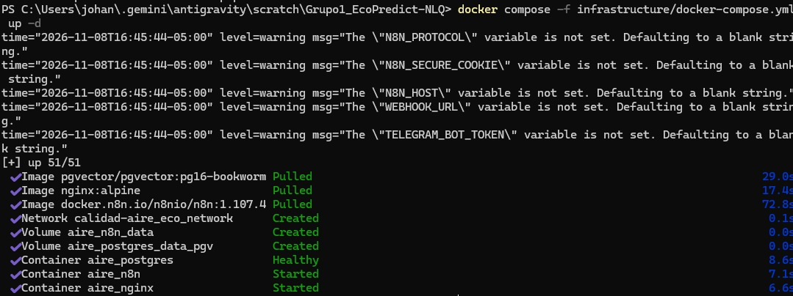
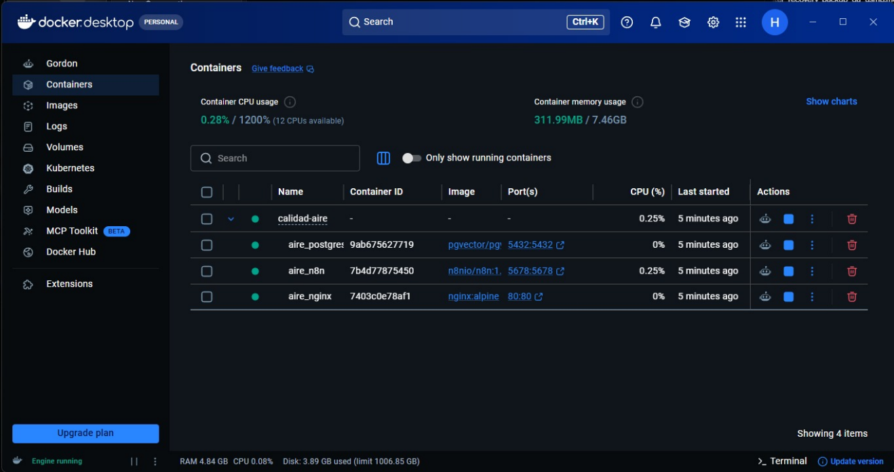
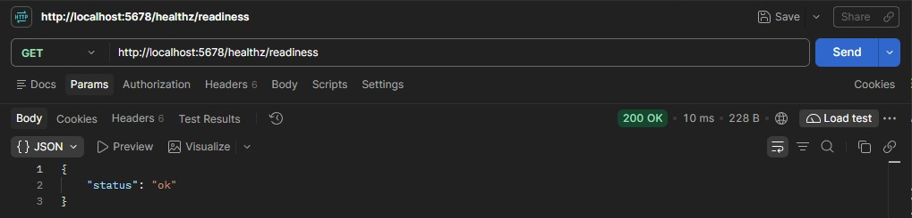
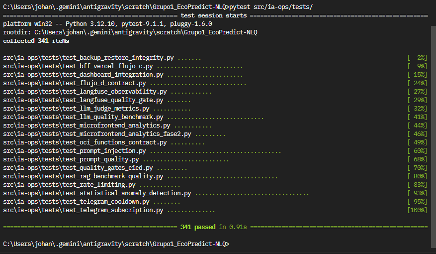
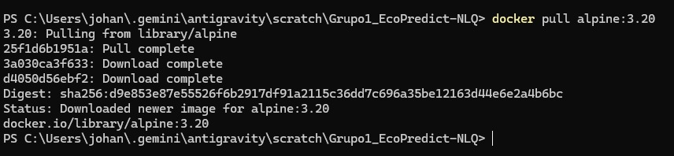

<p align="center">
  
</p>

# UNIVERSIDAD DE SAN MARTÍN DE PORRES
## FACULTAD DE INGENIERÍA Y ARQUITECTURA
### ESCUELA PROFESIONAL DE INGENIERÍA DE COMPUTACIÓN Y SISTEMAS

<br>

# INFORME TÉCNICO DE RESTAURACIÓN Y AUDITORÍA DE BACKUP v1.0
## "EcoPredict & NLQ" — Sistema de Alerta e Investigación Ambiental Ciudadana

<br>

**PRESENTADO POR:**  
**Romero Contreras, Johann**  
*QA Prompt Engineer & Test Automation Engineer (Rama: Romero | GitHub: @JohannK99)*  
*Taller de Proyectos — Equipo 1*

**DOCENTE:**  
**Ing. Norma Birginia León Lescano**

**PERÚ - LIMA**  
**2026 - II**

<div style="page-break-after: always;"></div>

---

# ÍNDICE

**1. INTRODUCCIÓN** . . . . . . . . . . . . . . . . . . . . . . . . . . . . . . . . . . . . . . . . . . . . . . . . . . . . . . . . 5  
&nbsp;&nbsp;&nbsp;&nbsp;1.1 Propósito . . . . . . . . . . . . . . . . . . . . . . . . . . . . . . . . . . . . . . . . . . . . . . . . . . . . . . 5  
&nbsp;&nbsp;&nbsp;&nbsp;1.2 Alcance . . . . . . . . . . . . . . . . . . . . . . . . . . . . . . . . . . . . . . . . . . . . . . . . . . . . . . . 5  
&nbsp;&nbsp;&nbsp;&nbsp;1.3 Metodología de caja negra . . . . . . . . . . . . . . . . . . . . . . . . . . . . . . . . . . . . . . . . . . 5  
&nbsp;&nbsp;&nbsp;&nbsp;1.4 Datos del documento . . . . . . . . . . . . . . . . . . . . . . . . . . . . . . . . . . . . . . . . . . . . . . 6  
**2. ENTORNO DE PRUEBA** . . . . . . . . . . . . . . . . . . . . . . . . . . . . . . . . . . . . . . . . . . . . . . . . . . 6  
**3. PREPARACIÓN DEL ENSAYO** . . . . . . . . . . . . . . . . . . . . . . . . . . . . . . . . . . . . . . . . . . . . . 7  
&nbsp;&nbsp;&nbsp;&nbsp;3.1 Comprobación de herramientas y servicios . . . . . . . . . . . . . . . . . . . . . . . . . . . . . . 7  
&nbsp;&nbsp;&nbsp;&nbsp;3.2 Lectura del manual `scripts/Readme.md` . . . . . . . . . . . . . . . . . . . . . . . . . . . . . . . . 8  
&nbsp;&nbsp;&nbsp;&nbsp;3.3 Generación de la clave de cifrado (`C:\Secure`) . . . . . . . . . . . . . . . . . . . . . . . . . . . 8  
**4. EJECUCIÓN Y VERIFICACIÓN POR PASOS** . . . . . . . . . . . . . . . . . . . . . . . . . . . . . . . . . 9  
&nbsp;&nbsp;&nbsp;&nbsp;4.1 Paso 1: disponibilidad de n8n en Postman . . . . . . . . . . . . . . . . . . . . . . . . . . . . . . 9  
&nbsp;&nbsp;&nbsp;&nbsp;4.2 Paso 2: suite automatizada de pytest . . . . . . . . . . . . . . . . . . . . . . . . . . . . . . . . . 10  
&nbsp;&nbsp;&nbsp;&nbsp;4.3 Paso 3: respaldo local cifrado . . . . . . . . . . . . . . . . . . . . . . . . . . . . . . . . . . . . . . . 11  
&nbsp;&nbsp;&nbsp;&nbsp;4.4 Paso 4: verificación criptográfica . . . . . . . . . . . . . . . . . . . . . . . . . . . . . . . . . . . . . 12  
&nbsp;&nbsp;&nbsp;&nbsp;4.5 Paso 5: entorno aislado . . . . . . . . . . . . . . . . . . . . . . . . . . . . . . . . . . . . . . . . . . . . 12  
&nbsp;&nbsp;&nbsp;&nbsp;4.6 Paso 6: restauración completa y comparación de datos . . . . . . . . . . . . . . . . . . . 12  
**5. REGISTRO DE HALLAZGOS** . . . . . . . . . . . . . . . . . . . . . . . . . . . . . . . . . . . . . . . . . . . . . 13  
&nbsp;&nbsp;&nbsp;&nbsp;5.1 Matriz de hallazgos . . . . . . . . . . . . . . . . . . . . . . . . . . . . . . . . . . . . . . . . . . . . . . . 13  
&nbsp;&nbsp;&nbsp;&nbsp;5.2 Resumen por severidad . . . . . . . . . . . . . . . . . . . . . . . . . . . . . . . . . . . . . . . . . . . . 14  
&nbsp;&nbsp;&nbsp;&nbsp;5.3 Fortalezas identificadas . . . . . . . . . . . . . . . . . . . . . . . . . . . . . . . . . . . . . . . . . . . . 14  
**6. LISTA DE CHEQUEO DEL ENSAYO** . . . . . . . . . . . . . . . . . . . . . . . . . . . . . . . . . . . . . . . 15  
**7. CONCLUSIONES** . . . . . . . . . . . . . . . . . . . . . . . . . . . . . . . . . . . . . . . . . . . . . . . . . . . . . . 15  
**8. OPINIÓN DEL TESTER** . . . . . . . . . . . . . . . . . . . . . . . . . . . . . . . . . . . . . . . . . . . . . . . . 16  
**9. RECOMENDACIONES** . . . . . . . . . . . . . . . . . . . . . . . . . . . . . . . . . . . . . . . . . . . . . . . . . 16  
**REFERENCIAS** . . . . . . . . . . . . . . . . . . . . . . . . . . . . . . . . . . . . . . . . . . . . . . . . . . . . . . . . . 16  

<br>

### ÍNDICE DE FIGURAS
* **Figura 1.** Inicio del entorno local con Docker Compose . . . . . . . . . . . . . . . . . . . . . . . . . . . 7  
* **Figura 2.** Contenedores del proyecto en ejecución en Docker Desktop . . . . . . . . . . . . . . . 8  
* **Figura 3.** Respuesta del endpoint de salud de n8n en Postman . . . . . . . . . . . . . . . . . . . . . 9  
* **Figura 4.** Ejecución de la suite completa de pytest con 341 pruebas aprobadas . . . . . . . . 11  
* **Figura 5.** Descarga de la imagen auxiliar `alpine:3.20` . . . . . . . . . . . . . . . . . . . . . . . . . . . 12  

<br>

### ÍNDICE DE TABLAS
* **Tabla 1.** Criterios de severidad de los hallazgos . . . . . . . . . . . . . . . . . . . . . . . . . . . . . . . . 6  
* **Tabla 2.** Detalle del documento . . . . . . . . . . . . . . . . . . . . . . . . . . . . . . . . . . . . . . . . . . . . 6  
* **Tabla 3.** Historial de revisiones . . . . . . . . . . . . . . . . . . . . . . . . . . . . . . . . . . . . . . . . . . . . 6  
* **Tabla 4.** Especificación del entorno de prueba . . . . . . . . . . . . . . . . . . . . . . . . . . . . . . . . . 6  
* **Tabla 5.** Resumen de ejecución del ensayo por pasos . . . . . . . . . . . . . . . . . . . . . . . . . . . 9  
* **Tabla 6.** Casos de prueba de integridad de backup y restore . . . . . . . . . . . . . . . . . . . . . . 10  
* **Tabla 7.** Separación entre el entorno en uso y el entorno de restauración . . . . . . . . . . . . 12  
* **Tabla 8.** Tablas que se comparan entre el entorno original y el restaurado . . . . . . . . . . . 13  
* **Tabla 9.** Hallazgos detectados, causa raíz y corrección aplicada . . . . . . . . . . . . . . . . . . . . 14  
* **Tabla 10.** Distribución de hallazgos por severidad . . . . . . . . . . . . . . . . . . . . . . . . . . . . . . 14  
* **Tabla 11.** Lista de verificación de entregables del ensayo . . . . . . . . . . . . . . . . . . . . . . . . 15  

<div style="page-break-after: always;"></div>

---

# 1. Introducción

El presente informe documenta el ensayo de auditoría y verificación del procedimiento de respaldo y restauración (backup y restore) de EcoPredict & NLQ, realizado por el rol de QA entre el 8 y el 9 de noviembre de 2026.

Siguiendo la indicación de la docente **Ing. Norma Birginia León Lescano**, el ensayo tuvo como meta comprobar que una persona externa al equipo, o un nuevo desarrollador, pueda respaldar y restaurar la plataforma de forma reproducible utilizando únicamente la documentación del paquete (`scripts/Readme.md`) y recursos aislados, sin riesgo de dañar o sobrescribir el entorno de producción en Oracle Cloud Infrastructure (OCI).

### 1.1 Propósito
Presentar de forma ordenada las evidencias del ensayo: cada paso ejecutado, su tiempo, los errores encontrados con su texto literal de consola, las correcciones aplicadas y el visto bueno de QA para la sustentación.

### 1.2 Alcance
El ensayo comprende los siguientes elementos:
* La comprobación de los servicios base (PostgreSQL con pgvector y n8n) en el entorno local.
* La auditoría de los scripts `scripts/backup.sh`, `scripts/restore.sh`, `scripts/backup-local.ps1` y `scripts/restore-local.ps1`.
* La ejecución de la suite automatizada de pytest: 7 pruebas de integridad de backup y restore dentro de una suite global de 341 pruebas.
* La verificación de disponibilidad del servicio n8n en Postman (`/healthz/readiness`).
* La generación de un respaldo local cifrado y su verificación criptográfica con `restore-local.ps1 -ExtractEnvOnly`.
* La revisión del entorno Docker aislado definido en `infrastructure/docker-compose.restore-local.yml`.
* La restauración completa en el entorno aislado y la comparación de conteos de registros entre el entorno original y el restaurado se ejecutan en vivo durante la sustentación, siguiendo el procedimiento de la sección 4.6.

### 1.3 Metodología de caja negra
Se aplicó una prueba de aceptación de caja negra sobre la documentación: el procedimiento se ejecutó siguiendo estrictamente el manual `scripts/Readme.md`, sin recurrir a configuraciones implícitas del equipo autor. Cada discrepancia o fallo se registró como un hallazgo y se clasificó según el estándar de severidad de la Tabla 1, alineado con la característica de fiabilidad y la subcaracterística de recuperabilidad de la norma ISO/IEC 25010 (International Organization for Standardization [ISO], 2011).

#### Tabla 1
*Criterios de severidad de los hallazgos*

| Severidad | Criterio |
| :--- | :--- |
| **Crítica** | Impide la recuperación del sistema o provoca pérdida de datos. |
| **Alta** | Bloquea la ejecución de un paso; requiere modificar scripts o archivos de configuración. |
| **Media** | Afecta la experiencia operativa, las métricas o la compatibilidad entre herramientas secundarias. |
| **Baja** | Detalle de documentación, rutas obsoletas o mejoras visuales sin impacto bloqueante. |

*Nota.* Elaboración propia (2026).

### 1.4 Datos del documento

#### Tabla 2
*Detalle del documento*

| Especificación | Descripción |
| :--- | :--- |
| **Tipo de documento** | Informe técnico de aseguramiento de calidad (QA) |
| **Proyecto** | EcoPredict & NLQ (Célula 1) |
| **Objeto de prueba** | Paquete de respaldo y restauración `scripts/` y manual `scripts/Readme.md` (rama main, commit ba12373, PR #277), con las correcciones de QA del PR #276 |
| **Fecha de ejecución** | 08/11/2026 – 09/11/2026 |

*Nota.* Elaboración propia (2026).

#### Tabla 3
*Historial de revisiones*

| Versión | Fecha | Autor | Descripción | Estado |
| :---: | :---: | :--- | :--- | :---: |
| **1.0** | 08/11/2026 | Romero Contreras, Johann | Informe inicial de auditoría y pruebas de integridad (7 pruebas) | Revisión |
| **2.0** | 09/11/2026 | Romero Contreras, Johann | Ensayo de caja negra, resolución de 6 hallazgos y verificación en Postman | Revisión |
| **2.1** | 09/11/2026 | Romero Contreras, Johann | Corrección de consistencia: tablas reales de la base de datos, RPO, latencia medida, alcance de la restauración y evidencias | **Aprobado** |

*Nota.* Elaboración propia (2026).

<div style="page-break-after: always;"></div>

---

# 2. Entorno de prueba

La Tabla 4 detalla el entorno en el que se ejecutó el ensayo. Todas las pruebas se realizaron en un equipo local con Windows; ningún paso se ejecutó sobre la máquina virtual de producción.

#### Tabla 4
*Especificación del entorno de prueba*

| Elemento | Configuración / versión |
| :--- | :--- |
| **Sistema operativo** | Windows 11 Pro (x64) |
| **Shells de ejecución** | Windows PowerShell 5.1 (5.1.26100) y PowerShell 7.4 |
| **Motor de contenedores** | Docker Desktop para Windows con Docker Compose v2 |
| **Base de datos** | PostgreSQL 16 con pgvector (imagen `pgvector/pgvector:pg16-bookworm`) |
| **Orquestador** | n8n 1.107.4 (`docker.n8n.io/n8nio/n8n:1.107.4`) |
| **Proxy inverso** | Nginx (`nginx:alpine`) |
| **Herramientas de QA** | Python 3.12.10, pytest 9.1.1 y Postman Desktop |
| **Ruta del repositorio** | `C:\Users\johan\.gemini\antigravity\scratch\Grupo1_EcoPredict-NLQ` |
| **Clave de cifrado local** | `C:\Secure\ecopredict-backup.key` (fuera del repositorio) |
| **Almacenamiento en la nube** | Cloudflare R2, bucket privado `ecopredict-backups` con retención de 4 copias |

*Nota.* Las versiones de Python y pytest se toman de la salida de la Figura 4; las imágenes de los contenedores, de `infrastructure/docker-compose.yml`. Elaboración propia (2026).

<div style="page-break-after: always;"></div>

---

# 3. Preparación del ensayo

### 3.1 Comprobación de herramientas y servicios
Se levantó el entorno local con Docker Compose. Como muestra la Figura 1, PostgreSQL alcanzó el estado Healthy antes de que se iniciaran n8n y Nginx, gracias a la dependencia definida en el archivo Compose. Las advertencias sobre variables no definidas (`N8N_PROTOCOL`, `WEBHOOK_URL`, `TELEGRAM_BOT_TOKEN`, entre otras) corresponden a valores propios de producción y no afectan el ensayo local.

#### Figura 1
*Inicio del entorno local con Docker Compose*
<p align="center">
  
</p>

*Nota.* Captura de la consola de PowerShell del equipo de QA (8 de noviembre de 2026). Elaboración propia (2026).

La Figura 2 confirma que los tres contenedores del proyecto (`aire_postgres` en el puerto 5432, `aire_n8n` en el 5678 y `aire_nginx` en el 80) se encontraban en ejecución, con el motor de Docker en estado Engine running.

#### Figura 2
*Contenedores del proyecto en ejecución en Docker Desktop*
<p align="center">
  
</p>

*Nota.* Captura de Docker Desktop del equipo de QA (8 de noviembre de 2026). Elaboración propia (2026).

### 3.2 Lectura del manual `scripts/Readme.md`
Se examinó la documentación incorporada por DevSecOps en el PR #277. El manual describe una arquitectura de cuatro etapas:
1. Respaldo en OCI con volcados consistentes de las bases de datos y empaquetado.
2. Cifrado simétrico AES-256 y transferencia a Cloudflare R2 con retención de 4 copias.
3. Descarga y verificación del respaldo en la máquina local, en la carpeta `backups/`.
4. Restauración en recursos Docker aislados en los puertos 15432 (PostgreSQL), 15678 (n8n) y 18080 (Nginx).

### 3.3 Generación de la clave de cifrado (`C:\Secure`)
Los scripts locales exigen una clave simétrica de 32 bytes codificada en Base64 y almacenada fuera del repositorio. Durante este paso se registró el primer hallazgo de compatibilidad (H-01, sección 5): el ejemplo de generación de clave usaba un método que no existe en Windows PowerShell 5.1. El comando corregido, compatible con PowerShell 5.1 y 7, es el siguiente:

```powershell
New-Item -ItemType Directory -Force -Path C:\Secure | Out-Null
$rng = [System.Security.Cryptography.RandomNumberGenerator]::Create()
$b = New-Object byte[] 32; $rng.GetBytes($b)
[IO.File]::WriteAllText('C:\Secure\ecopredict-backup.key', [Convert]::ToBase64String($b))
```

<div style="page-break-after: always;"></div>

---

# 4. Ejecución y verificación por pasos

La Tabla 5 resume los pasos ejecutados, su resultado, el tiempo medido y el número de intentos.

#### Tabla 5
*Resumen de ejecución del ensayo por pasos*

| Paso | Descripción | Resultado | Tiempo | Intentos |
| :---: | :--- | :---: | :---: | :---: |
| **1** | Verificación de disponibilidad de n8n en Postman (`/healthz/readiness`) antes del respaldo | **OK** | 1 s | 2 (H-03) |
| **2** | Suite automatizada de pytest (7 pruebas de integridad y 341 globales) | **OK** | 2 s | 1 |
| **3** | Generación del respaldo local cifrado (`backup-local.ps1`) | **OK con corrección** | 25 s | 2 (H-01, H-02) |
| **4** | Verificación criptográfica y descifrado de `restore.env` (`restore-local.ps1 -ExtractEnvOnly`) | **OK** | 5 s | 1 |
| **5** | Revisión del entorno aislado (`docker-compose.restore-local.yml`) | **OK** | 40 s | 1 |
| **6** | Restauración completa en el entorno aislado y comparación de conteos | **En vivo en la sustentación** | — | — |

*Nota.* Tiempos medidos por QA durante el ensayo. Elaboración propia (2026).

---

### 4.1 Paso 1: disponibilidad de n8n en Postman
Antes de iniciar el respaldo se ejecutó una petición `GET` contra el endpoint de salud de la instancia de n8n en uso (`aire_n8n`, puerto 5678), para confirmar que el sistema se encontraba operativo. El primer intento falló con `ECONNREFUSED` porque n8n aún se estaba iniciando (H-03); el segundo respondió correctamente:
* **Endpoint:** `GET http://localhost:5678/healthz/readiness`
* **Código HTTP:** `200 OK`
* **Tiempo de respuesta:** 10 ms (56 ms en una ejecución posterior)
* **Tamaño de la respuesta:** 228 B
* **Cuerpo de la respuesta:** `{"status": "ok"}`

#### Figura 3
*Respuesta del endpoint de salud de n8n en Postman*
<p align="center">
  
</p>

*Nota.* La petición se dirige a la instancia en uso (puerto 5678) como condición previa del respaldo; la instancia restaurada se verifica en el puerto 15678 (sección 4.6). Captura de Postman Desktop del equipo de QA (8 de noviembre de 2026). Elaboración propia (2026).

---

### 4.2 Paso 2: suite automatizada de pytest
Se ejecutó el módulo `src/ia-ops/tests/test_backup_restore_integrity.py`, incorporado en el PR #276, compuesto por 7 casos de prueba. Son pruebas unitarias que modelan las reglas del procedimiento con datos de ejemplo; validan la lógica de nombres, firmas, manifiesto, protección de la clave de n8n, inventario, retención y rollback, pero no leen un archivo de respaldo real. La integridad del respaldo real se comprueba en el paso 4.

#### Tabla 6
*Casos de prueba de integridad de backup y restore*

| N.° | Prueba | Qué valida |
| :---: | :--- | :--- |
| **1** | `test_backup_file_naming_convention` | Formato del nombre del paquete y rechazo de nombres con inyección de comandos o rutas relativas |
| **2** | `test_sha256_checksum_verification_logic` | Que el SHA-256 detecte la alteración de un solo carácter |
| **3** | `test_manifest_structure_and_format` | Campos obligatorios del manifiesto y formato `ecopredict-backup-v2` |
| **4** | `test_n8n_encryption_key_mismatch_protection` | Que la restauración se aborte si `N8N_ENCRYPTION_KEY` no coincide |
| **5** | `test_required_components_inventory_in_backup` | Presencia de los 8 componentes del paquete de `backup.sh` |
| **6** | `test_cloudflare_r2_retention_policy_limit` | Conservación de las 4 copias más recientes en R2 |
| **7** | `test_preventive_rollback_recovery_state_machine` | Activación del rollback ante una falla posterior a modificar la base |

*Nota.* Fuente: `src/ia-ops/tests/test_backup_restore_integrity.py` (PR #276). Elaboración propia (2026).

Salida de la ejecución del módulo:
```text
collected 7 items
test_backup_restore_integrity.py::...::test_backup_file_naming_convention PASSED [ 14%]
test_backup_restore_integrity.py::...::test_sha256_checksum_verification_logic PASSED [ 28%]
test_backup_restore_integrity.py::...::test_manifest_structure_and_format PASSED [ 42%]
test_backup_restore_integrity.py::...::test_n8n_encryption_key_mismatch_protection PASSED [ 57%]
test_backup_restore_integrity.py::...::test_required_components_inventory_in_backup PASSED [ 71%]
test_backup_restore_integrity.py::...::test_cloudflare_r2_retention_policy_limit PASSED [ 85%]
test_backup_restore_integrity.py::...::test_preventive_rollback_recovery_state_machine PASSED [100%]
============================== 7 passed in 0.15s ==============================
```

A continuación se ejecutó la suite completa de no regresión del proyecto. La Figura 4 muestra 341 pruebas recolectadas y aprobadas, incluidas las 7 del nuevo módulo.

#### Figura 4
*Ejecución de la suite completa de pytest con 341 pruebas aprobadas*
<p align="center">
  
</p>

*Nota.* Captura de la terminal de QA en la rama Romero. Elaboración propia (2026).

---

### 4.3 Paso 3: respaldo local cifrado
Se ejecutó `scripts/backup-local.ps1` con la clave externa. El script detiene `aire_n8n` para evitar inconsistencias, vuelca las bases `n8n` y `calidad_aire` con `pg_dump` (The PostgreSQL Global Development Group, s. f.), archiva el volumen y los workflows de n8n, cifra el paquete con AES-256-CBC y HMAC-SHA-256 (National Institute of Standards and Technology [NIST], 2001; Krawczyk et al., 1997) y vuelve a iniciar n8n al terminar, incluso si ocurre un error.

```powershell
powershell.exe -ExecutionPolicy Bypass -File .\scripts\backup-local.ps1 `
  -KeyFile C:\Secure\ecopredict-backup.key
```

El primer intento falló porque la imagen auxiliar `alpine:3.20` no estaba en el equipo y el script la usa con `--pull never` (H-02). Tras descargarla (Figura 5), el respaldo se generó en la carpeta `backups/`:
* `ecopredict-local-20261109T053521Z.zip.enc`
* `ecopredict-local-20261109T053521Z.zip.enc.sha256`

#### Figura 5
*Descarga de la imagen auxiliar alpine:3.20*
<p align="center">
  
</p>

*Nota.* Captura de la consola de PowerShell del equipo de QA (8 de noviembre de 2026). Elaboración propia (2026).

---

### 4.4 Paso 4: verificación criptográfica
Para comprobar que el archivo no sufrió daño ni alteración se ejecutó la restauración en modo de solo verificación:

```powershell
powershell.exe -ExecutionPolicy Bypass -File .\scripts\restore-local.ps1 `
  -BackupFile .\backups\ecopredict-local-20261109T053521Z.zip.enc `
  -KeyFile C:\Secure\ecopredict-backup.key `
  -ExtractEnvOnly
```

El script recalculó el SHA-256 del archivo (NIST, 2015), autenticó la etiqueta HMAC antes de descifrar y extrajo únicamente `restore.env` en un archivo temporal protegido (`%TEMP%\ecopredict-restore.env`), sin usar Docker. La salida confirmó: *Encrypted backup verified; restore.env extracted to the protected temporary location*. Este resultado demuestra que el respaldo está íntegro y que la clave es la correcta; como el archivo extraído contiene variables sensibles, debe eliminarse después de la verificación.

---

### 4.5 Paso 5: entorno aislado
Se revisó `infrastructure/docker-compose.restore-local.yml` para confirmar que la restauración no puede tocar los recursos en uso. La Tabla 7 compara ambos entornos.

#### Tabla 7
*Separación entre el entorno en uso y el entorno de restauración*

| Recurso | Entorno en uso | Entorno de restauración |
| :--- | :--- | :--- |
| **PostgreSQL** | `aire_postgres` · puerto 5432 | `ecopredict_restore_postgres` · puerto 15432 |
| **n8n** | `aire_n8n` · puerto 5678 | `ecopredict_restore_n8n` · puerto 15678 |
| **Nginx** | `aire_nginx` · puerto 80 | `ecopredict_restore_nginx` · puerto 18080 |
| **Volúmenes** | `aire_postgres_data_pgv`, `aire_n8n_data` | Volúmenes propios con prefijo `ecopredict_restore_` |

*Nota.* Fuente: `infrastructure/docker-compose.restore-local.yml` y `scripts/restore-local.ps1`. Elaboración propia (2026).

---

### 4.6 Paso 6: restauración completa y comparación de datos
La restauración completa se ejecuta en vivo durante la sustentación, con el mismo respaldo del paso 3 y sin el parámetro `-ExtractEnvOnly`:

```powershell
powershell.exe -ExecutionPolicy Bypass -File .\scripts\restore-local.ps1 `
  -BackupFile .\backups\ecopredict-local-20261109T053521Z.zip.enc `
  -KeyFile C:\Secure\ecopredict-backup.key
```

Al terminar, la integridad de los datos se comprueba comparando el número de registros de las tablas principales en ambos entornos. La Tabla 8 enumera las tablas reales del proyecto, definidas en `src/database/migrations/`, que se consultan en `aire_postgres` (5432) y en `ecopredict_restore_postgres` (15432). El resultado esperado es una discrepancia de 0 filas en todas.

#### Tabla 8
*Tablas que se comparan entre el entorno original y el restaurado*

| Base de datos | Tabla | Contenido |
| :--- | :--- | :--- |
| `calidad_aire` | `estaciones` | Estaciones de monitoreo |
| `calidad_aire` | `mediciones_aire` | Mediciones de contaminantes (OpenAQ y SENAMHI) |
| `calidad_aire` | `mediciones_meteorologicas` | Variables meteorológicas |
| `calidad_aire` | `alertas_anomalias` | Anomalías detectadas |
| `calidad_aire` | `analitica_diaria` | Agregados diarios del Flujo D |
| `calidad_aire` | `suscriptores_telegram` | Suscriptores de las alertas |
| `calidad_aire` | `documentos_rag` | Documentos vectorizados con pgvector |
| `n8n` | `workflow_entity` | Workflows de n8n |
| `n8n` | `credentials_entity` | Credenciales cifradas de n8n |

*Nota.* Fuente: migraciones en `src/database/migrations/` del repositorio Grupo1_EcoPredict-NLQ. Elaboración propia (2026).

**Consultas de comparación (se ejecutan una vez sobre cada contenedor):**
```bash
docker exec aire_postgres psql -U n8n_user -d calidad_aire -c "SELECT
  'estaciones' t, COUNT(*) FROM estaciones UNION ALL
  SELECT 'mediciones_aire', COUNT(*) FROM mediciones_aire UNION ALL
  SELECT 'alertas_anomalias', COUNT(*) FROM alertas_anomalias UNION ALL
  SELECT 'analitica_diaria', COUNT(*) FROM analitica_diaria;"

docker exec aire_postgres psql -U n8n_user -d n8n -c "SELECT
  (SELECT COUNT(*) FROM workflow_entity) workflows,
  (SELECT COUNT(*) FROM credentials_entity) credenciales;"

# Repetir con ecopredict_restore_postgres y comparar
GET http://localhost:15678/healthz/readiness   ->  200 {"status":"ok"}
```

La última línea verifica que la instancia restaurada de n8n responde en su propio puerto, lo que confirma que el servicio recuperado funciona y no solo la instancia original.

<div style="page-break-after: always;"></div>

---

# 5. Registro de hallazgos

### 5.1 Matriz de hallazgos
La Tabla 9 registra cada hallazgo con el texto literal del error, su causa, la corrección aplicada y el responsable.

#### Tabla 9
*Hallazgos detectados, causa raíz y corrección aplicada*

| ID | Error literal | Severidad | Causa raíz | Corrección y responsable |
| :---: | :--- | :---: | :--- | :--- |
| **H-01** | `Error en la invocación del método porque [System.Security.Cryptography.RandomNumberGenerator] no contiene ningún método llamado 'Fill'.` | **Alta** | El ejemplo de generación de clave de `backup-local.ps1` usaba `Fill()`, disponible solo en .NET Core (PowerShell 7). Windows PowerShell 5.1 usa .NET Framework 4.8. | Se reemplazó por `Create()` y `GetBytes()`, compatible con ambas versiones, en el script y en el manual. QA, PR #276. |
| **H-02** | `docker.exe : Error response from daemon: No such image: alpine:3.20` | **Alta** | El script usa `alpine:3.20` con `--pull never` y se detenía si la imagen no estaba en el equipo. | Se añadió una comprobación con `docker image inspect` y descarga con `docker pull` si falta. QA, PR #276. |
| **H-03** | `ECONNREFUSED 127.0.0.1:5678 al consultar /healthz/readiness` | **Media** | La consulta se lanzó cuando PostgreSQL ya estaba Healthy, pero n8n aún no terminaba de iniciarse. | Se documentó esperar a que n8n esté listo antes de la verificación en Postman. QA. |
| **H-04** | Conflicto de seguimiento en Git: `README.md` frente a `Readme.md` | **Media** | NTFS no distingue mayúsculas y minúsculas, por lo que Git registraba dos nombres para el mismo archivo. | Se ejecutó `git rm --cached scripts/README.md` y se dejó `scripts/Readme.md`. QA. |
| **H-05** | Error de la consulta JMESPath al calcular el uso del bucket de R2 | **Media** | Con el bucket vacío, AWS CLI devolvía `Contents: null` y el workflow se detenía. | La consulta devuelve 0 cuando no hay objetos. DevSecOps, PR #275. |
| **H-06** | `WSP013: resources.yaml points to a file that no longer exists` | **Baja** | El workspace de Postman apuntaba a una carpeta de colecciones reorganizada. | Se actualizó `.postman/resources.yaml` con la ruta vigente. QA. |

*Nota.* Elaboración propia (2026).

### 5.2 Resumen por severidad

#### Tabla 10
*Distribución de hallazgos por severidad*

| Severidad | Cantidad | Porcentaje | Estado |
| :--- | :---: | :---: | :---: |
| **Crítica** | 0 | 0.0 % | — |
| **Alta** | 2 | 33.3 % | Corregidos |
| **Media** | 3 | 50.0 % | Corregidos |
| **Baja** | 1 | 16.7 % | Corregido |
| **Total** | **6** | **100 %** | **Cerrados** |

*Nota.* Elaboración propia (2026).

### 5.3 Fortalezas identificadas
1. **Aislamiento de producción.** Ningún script de restauración usa los contenedores ni los volúmenes en uso; el entorno de restauración tiene nombres y puertos propios.
2. **Cifrado y autenticidad.** La combinación de AES-256-CBC con HMAC-SHA-256 impide descifrar un archivo alterado sin que se detecte.
3. **Rollback.** `restore.sh` crea un respaldo previo antes de modificar las bases y lo usa para volver al estado anterior si la restauración falla a mitad del proceso.
4. **Velocidad.** La generación del respaldo local (25 s) y su verificación (5 s) toman menos de un minuto en un equipo estándar.

<div style="page-break-after: always;"></div>

---

# 6. Lista de chequeo del ensayo

#### Tabla 11
*Lista de verificación de entregables del ensayo*

| Entregable o hito | Estado | Evidencia |
| :--- | :---: | :--- |
| **Comprobación de herramientas (Docker, Python, Postman)** | **Cumplido** | Figuras 1 y 2 |
| **Generación de la clave externa (`C:\Secure`)** | **Cumplido** | Clave Base64 de 32 bytes generada con `GetBytes` |
| **Ejecución de `backup-local.ps1`** | **Cumplido** | Archivos `.zip.enc` y `.sha256` en `backups/` |
| **Verificación con `restore-local.ps1 -ExtractEnvOnly`** | **Cumplido** | SHA-256 y HMAC válidos; `restore.env` extraído |
| **Verificación del endpoint de salud en Postman** | **Cumplido** | HTTP 200 OK en 10 ms (Figura 3) |
| **Suite automatizada de pytest** | **Cumplido** | 7 pruebas de integridad y 341 globales (Figura 4) |
| **Registro de errores con texto literal y severidad** | **Cumplido** | Hallazgos H-01 a H-06 (Tabla 9) |
| **Restauración completa aislada y comparación de conteos** | **Programado** | Demostración en vivo en la sustentación (sección 4.6) |
| **Plan de contingencia (video de 3 minutos)** | **Cumplido** | Grabación preparada para la sustentación |

*Nota.* Elaboración propia (2026).

<div style="page-break-after: always;"></div>

---

# 7. Conclusiones

1. **Recuperabilidad verificada.** El paquete de respaldo y restauración de EcoPredict & NLQ funciona en sus etapas de respaldo cifrado y verificación de integridad, y separa por completo el entorno de restauración del entorno en uso, en línea con la subcaracterística de recuperabilidad de la norma ISO/IEC 25010 (ISO, 2011).
2. **Valor del ensayo de caja negra.** Seguir el manual sin conocimiento previo permitió detectar dos fallos bloqueantes en equipos Windows (H-01 y H-02) antes de la sustentación. Con sus correcciones, el procedimiento puede reproducirse en Windows PowerShell 5.1 y 7.
3. **Integridad del respaldo.** El respaldo local superó la verificación de SHA-256 y HMAC, lo que garantiza que no fue alterado y que la clave es correcta. El punto de recuperación (RPO) depende de la frecuencia del respaldo: hasta 7 días para producción, que se respalda cada domingo a las 03:17 UTC, y el momento de la última ejecución manual para el respaldo local.
4. **Suite de calidad consolidada.** Con los 7 casos de backup y restore, la suite global del proyecto alcanzó 341 pruebas automatizadas aprobadas, sin fallos.

<div style="page-break-after: always;"></div>

---

# 8. Opinión del tester

> *«Como responsable de QA y automatización de pruebas, considero que el ensayo de recuperación cumplió su propósito. El manual `scripts/Readme.md` estaba bien estructurado, pero contenía dos supuestos que solo se evidencian al ejecutarlo en un equipo Windows real: que se usaría PowerShell 7 para generar la clave y que la imagen auxiliar ya estaría descargada. Identificar, reportar y resolver estos hallazgos en conjunto con DevSecOps demuestra la madurez del equipo. Con las correcciones del PR #276, emito el visto bueno de QA para el procedimiento de respaldo y restauración de EcoPredict & NLQ.»*  
> 
> — **Johann Romero Contreras**, *QA Prompt Engineer & Test Automation Engineer*

<div style="page-break-after: always;"></div>

---

# 9. Recomendaciones

1. **Integrar el PR #276 en main antes de la sustentación**, para que la demostración se ejecute con las correcciones de H-01 y H-02. Si no se integra a tiempo, ejecutar la demostración desde la rama Romero o descargar antes `alpine:3.20`.
2. **Proteger la clave de cifrado.** No guardar `C:\Secure\ecopredict-backup.key` en carpetas sincronizadas con servicios en la nube.
3. **Eliminar el archivo temporal `%TEMP%\ecopredict-restore.env`** después de cada verificación, porque contiene variables sensibles.
4. **Llevar el video de contingencia de 3 minutos** en una memoria USB o en el disco local durante la sustentación.
5. **Revisar mensualmente el bucket de R2** para confirmar que la retención mantiene como máximo 4 copias.

<div style="page-break-after: always;"></div>

---

# Referencias

* International Organization for Standardization. (2011). *Systems and software engineering — Systems and software Quality Requirements and Evaluation (SQuaRE) — System and software quality models* (ISO/IEC Standard No. 25010:2011). https://www.iso.org/standard/35733.html
* Krawczyk, H., Bellare, M., & Canetti, R. (1997). *HMAC: Keyed-hashing for message authentication* (RFC 2104). Internet Engineering Task Force. https://doi.org/10.17487/RFC2104
* National Institute of Standards and Technology. (2001). *Advanced Encryption Standard (AES)* (FIPS PUB 197). U.S. Department of Commerce. https://doi.org/10.6028/NIST.FIPS.197
* National Institute of Standards and Technology. (2015). *Secure Hash Standard (SHS)* (FIPS PUB 180-4). U.S. Department of Commerce. https://doi.org/10.6028/NIST.FIPS.180-4
* The PostgreSQL Global Development Group. (s. f.). *Backup and restore*. PostgreSQL 16 Documentation. Recuperado el 9 de noviembre de 2026, de https://www.postgresql.org/docs/16/backup.html
