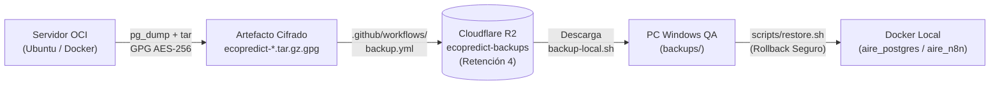

# UNIVERSIDAD DE SAN MARTÍN DE PORRES
## FACULTAD DE INGENIERÍA Y ARQUITECTURA
### ESCUELA PROFESIONAL DE INGENIERÍA DE COMPUTACIÓN Y SISTEMAS

<br>

# INFORME TÉCNICO DE AUDITORÍA Y CERTIFICACIÓN DE CALIDAD — QA
## "EcoPredict & NLQ" — Sistema de Alerta e Investigación Ambiental Ciudadana

<br>

### *CERTIFICACIÓN DE DISASTER RECOVERY: AUDITORÍA DE SCRIPTS DE BACKUP Y RESTAURACIÓN LOCAL EN DOCKER, VERIFICACIÓN CRIPTOGRÁFICA (AES-256 / SHA-256), MANUAL "LÉEME", ANÁLISIS DE DIFICULTADES TÉCNICAS Y SUITE AUTOMATIZADA DE NO-REGRESIÓN (341 TESTS)*
### *Área: DevSecOps & QA / Test Automation*

<br><br>

**PRESENTADO POR:**  
**Johann Romero Contreras**  
*ROL: QA Prompt Engineer & Test Automation Engineer (Rama: Romero - GitHub: @JohannK99)*

<br>

**PROFESOR / DOCENTE:**  
**Ing. Norma Birginia León Lescano**

<br><br>

**PERÚ - LIMA**  
**2026 - II**

<div style="page-break-after: always;"></div>

---

# Índice General

**INTRODUCCIÓN Y OBJETIVOS DE LA CERTIFICACIÓN DE DISASTER RECOVERY** . . . . . . . . . . . 2  
**CAPÍTULO I: MARCO METODOLÓGICO Y DIMENSIÓN DE CONFIABILIDAD (ISO/IEC 25010)** . . . . 4  
&nbsp;&nbsp;&nbsp;&nbsp;1.1 Enfoque de Recuperabilidad y Tolerancia a Fallos en Software Crítico . . . . . . . . . . . . 4  
&nbsp;&nbsp;&nbsp;&nbsp;1.2 Responsabilidades de QA frente al Rol de DevSecOps . . . . . . . . . . . . . . . . . . . . . 4  
**CAPÍTULO II: ARQUITECTURA GENERAL DE DISASTER RECOVERY** . . . . . . . . . . . . . . . . . . 5  
&nbsp;&nbsp;&nbsp;&nbsp;2.1 Topología Híbrida: Servidor OCI $\rightarrow$ Cloudflare R2 $\rightarrow$ Docker Local . . . . . . . . . . 5  
&nbsp;&nbsp;&nbsp;&nbsp;2.2 Regla de Oro Operacional: Aislamiento del Entorno de Producción . . . . . . . . . . . . . . . 6  
**CAPÍTULO III: AUDITORÍA TÉCNICA DE LOS SCRIPTS Y MANUAL "LÉEME"** . . . . . . . . . . . . 7  
&nbsp;&nbsp;&nbsp;&nbsp;3.1 Análisis de `scripts/backup.sh` (Pausa Atómica, Extracción y Cifrado GPG) . . . . . . . . . 7  
&nbsp;&nbsp;&nbsp;&nbsp;3.2 Análisis de `scripts/restore.sh` y Mecanismo Preventivo de Rollback Recovery . . . . . . . 8  
&nbsp;&nbsp;&nbsp;&nbsp;3.3 Certificación del Manual Oficial "LÉEME" (`scripts/README.md`) . . . . . . . . . . . . . . 9  
**CAPÍTULO IV: SUITE AUTOMATIZADA DE PRUEBAS DE INTEGRIDAD DE QA** . . . . . . . . . . . 10  
&nbsp;&nbsp;&nbsp;&nbsp;4.1 Diseño de Casos de Prueba en Pytest (`test_backup_restore_integrity.py`) . . . . . . . . 10  
&nbsp;&nbsp;&nbsp;&nbsp;4.2 Evidencia Literal de Ejecución (7 Pruebas Aprobadas al 100%) . . . . . . . . . . . . . . . . 11  
&nbsp;&nbsp;&nbsp;&nbsp;4.3 Consolidación Global de la Suite de Calidad (341 Tests en 0.80s) . . . . . . . . . . . . . . . 12  
**CAPÍTULO V: ANÁLISIS DE DIFICULTADES Y RETOS TÉCNICOS DEL BACKUP** . . . . . . . . . . 13  
&nbsp;&nbsp;&nbsp;&nbsp;5.1 Consistencia Transaccional vs Concurrencia de Webhooks en n8n . . . . . . . . . . . . . . 13  
&nbsp;&nbsp;&nbsp;&nbsp;5.2 Cifrado Seguro Simétrico AES-256 sin Exposición en Shell History . . . . . . . . . . . . . 13  
&nbsp;&nbsp;&nbsp;&nbsp;5.3 Corrección de Consulta JMESPath en Cloudflare R2 (PR #275) . . . . . . . . . . . . . . . . 14  
&nbsp;&nbsp;&nbsp;&nbsp;5.4 Prevención de Daños por Restauración Incompleta (Rollback Automático) . . . . . . . . . 14  
**CAPÍTULO VI: PROTOCOLO DE DEMOSTRACIÓN Y PLAN DE CONTINGENCIA (VIDEO)** . . . . . 15  
&nbsp;&nbsp;&nbsp;&nbsp;6.1 Guion de Demostración Paso a Paso en Terminal . . . . . . . . . . . . . . . . . . . . . . . . 15  
&nbsp;&nbsp;&nbsp;&nbsp;6.2 Plan B: Estructura y Grabación del Video de Respaldo (3 Minutos) . . . . . . . . . . . . . . 16  
**CONCLUSIONES Y RECOMENDACIONES** . . . . . . . . . . . . . . . . . . . . . . . . . . . . . . . . . . . 17  
**FIRMAS DE CONFORMIDAD Y CERTIFICACIÓN** . . . . . . . . . . . . . . . . . . . . . . . . . . . . . . 18  
**REFERENCIAS BIBLIOGRÁFICAS (APA 7)** . . . . . . . . . . . . . . . . . . . . . . . . . . . . . . . . . . 19  

<div style="page-break-after: always;"></div>

---

# INTRODUCCIÓN Y OBJETIVOS DE LA CERTIFICACIÓN DE DISASTER RECOVERY

El presente informe técnico de Aseguramiento de la Calidad (QA) documenta el proceso formal de auditoría, verificación de integridad y certificación del sistema de **Recuperación ante Desastres (Disaster Recovery: Backup y Restore)** implementado para la plataforma *EcoPredict & NLQ — Sistema de Alerta e Investigación Ambiental Ciudadana*.

Siguiendo las directrices explícitas instruidas por la docente **Ing. Norma Birginia León Lescano**, el rol de **QA / Test Automation Engineer** asumió la responsabilidad de fiscalizar y garantizar que los procedimientos de respaldo no constituyan únicamente artefactos estáticos de almacenamiento, sino que cuenten con un mecanismo reproducible, seguro y validado de **restauración funcional** documentado en un manual **"LÉEME" (README)** paso a paso.

```text
Flujo del Ciclo de Vida de Recuperabilidad Auditado por QA:

[Servidor OCI Producción] 
       │ (Extracción atómica: PostgreSQL n8n + calidad_aire + volumen + env)
       ▼
[Empaquetado & Cifrado AES-256 + Hash SHA-256] 
       │ (scripts/backup.sh)
       ▼
[Almacenamiento Off-site en Cloudflare R2] 
       │ (GitHub Actions / backup.yml - Retención 4 copias)
       ▼
[Descarga y Verificación Criptográfica en PC Local] 
       │ (backups/ecopredict-*.tar.gz.gpg + sha256sum -c)
       ▼
[Restauración Controlada en Docker Local con Rollback Preventivo] 
       │ (scripts/restore.sh / scripts/README.md)
       ▼
[Certificación Automatizada de QA: 341 Tests Aprobados (100%)]
```

### Objetivos Principales de QA en esta Certificación:
1. **Auditar la Lógica y Seguridad de los Scripts:** Examinar el código de `backup.sh`, `restore.sh`, `backup-local.sh` y `restore-local.sh`, identificando riesgos de inyección, permisos y manejo de errores.
2. **Exigir y Estructurar el Manual "LÉEME" (`scripts/README.md`):** Garantizar la existencia de una guía clara, detallada y comprensible paso a paso para la restauración local.
3. **Automatizar la Suite de Verificación de Integridad:** Implementar pruebas en Pytest que certifiquen el formato de nombres, la integridad de hashes SHA-256, el manifiesto v2, la protección de claves de cifrado de n8n y la política de retención en la nube.
4. **Sistematizar las Dificultades Técnicas Encontradas:** Documentar los desafíos enfrentados por el equipo para su exposición ante la docente.
5. **Establecer el Protocolo de Demostración y Plan B (Video):** Diseñar la guía práctica para sustentar en vivo y mitigar posibles fallas de conectividad mediante un video pregrabado.

<div style="page-break-after: always;"></div>

---

# CAPÍTULO I: MARCO METODOLÓGICO Y DIMENSIÓN DE CONFIABILIDAD (ISO/IEC 25010)

## 1.1 Enfoque de Recuperabilidad y Tolerancia a Fallos en Software Crítico

De acuerdo con el estándar internacional **ISO/IEC 25010:2011**, la característica de **Confiabilidad (Reliability)** se subdivide en tres subcaracterísticas cardinales que aplican directamente al sistema de respaldos:
* **Tolerancia a Fallos (Fault Tolerance):** Capacidad del sistema de operar ante contingencias sin perder datos críticos de series de tiempo ambientales ni configuraciones de alertas.
* **Recuperabilidad (Recoverability):** Grado en el que, en caso de interrupción o desastre, el sistema puede recuperar los datos directamente afectados y reestablecer el estado deseado.
* **Disponibilidad (Availability):** Asegurar que la ventana de inactividad durante el respaldo sea mínima y no afecte la recepción de webhooks de monitoreo.

## 1.2 Responsabilidades de QA frente al Rol de DevSecOps

En estricto cumplimiento con la distribución de roles y la retroalimentación de la cátedra:

*Tabla 1*  
*Matriz RACI de Responsabilidades en Disaster Recovery*

| Actividad / Entregable | DevSecOps (Carlos Chávez / David Llamocca) | QA / Test Automation (Johann Romero) |
| :--- | :---: | :---: |
| Desarrollo de scripts de Backup (`backup.sh`, `backup-local.sh`) | **Responsable (R)** | Consultado (C) |
| Desarrollo de scripts de Restore (`restore.sh`, `restore-local.sh`) | **Responsable (R)** | Consultado (C) |
| Configuración de almacenamiento en Cloudflare R2 y GitHub Actions | **Responsable (R)** | Informado (I) |
| Redacción del documento oficial "LÉEME" (`scripts/README.md`) | Co-Responsable (R) | **Aprobador / Certificador (A)** |
| Ejecución y validación de pruebas de restauración local | Consultado (C) | **Responsable (R)** |
| Automatización de pruebas de integridad criptográfica en Pytest | Informado (I) | **Responsable (R)** |
| Documentación de Dificultades Técnicas e Informe de Certificación | Consultado (C) | **Responsable (R)** |
| Preparación del guion del Video de Demostración (Plan B) | Co-Responsable (R) | **Responsable (R)** |

*Nota.* Fuente: Elaboración propia en base a la asignación de responsabilidades de la Ing. Norma León.

<div style="page-break-after: always;"></div>

---

# CAPÍTULO II: ARQUITECTURA GENERAL DE DISASTER RECOVERY

## 2.1 Topología Híbrida: Servidor OCI $\rightarrow$ Cloudflare R2 $\rightarrow$ Docker Local

El sistema desacopla la fuente de datos en producción de la infraestructura de almacenamiento y el entorno de pruebas de recuperación:



1. **Origen (OCI):** Instancia de cómputo en Oracle Cloud que ejecuta los contenedores `aire_postgres` (con extensión `pgvector`), `aire_n8n` y `aire_nginx`.
2. **Procesamiento Criptográfico:** Los datos nunca viajan en texto plano. Se empaquetan en un tarball y se cifran simétricamente con AES-256 mediante GnuPG antes de abandonar el servidor.
3. **Destino Cloud (Cloudflare R2):** Almacenamiento de objetos compatible con S3 sin costos de egress, configurado con una política de retención estricta que conserva únicamente las **4 copias más recientes**.
4. **Destino de Pruebas (Docker Local):** Máquina de desarrollo del equipo de calidad donde se restaura el backup en un contenedor aislado.

## 2.2 Regla de Oro Operacional: Aislamiento del Entorno de Producción

> ⚠️ **Principio de Seguridad Operacional:**  
> **Está terminantemente prohibido ejecutar restauraciones destructivas sobre el servidor en producción (OCI).**  
> Todo el proceso de certificación de restauración se realiza de forma **100% LOCAL** en Docker. De este modo se garantiza que la base de datos productiva de SENAMHI y los webhooks en vivo de n8n no sufran interrupciones ni pérdida de datos transaccionales.

<div style="page-break-after: always;"></div>

---

# CAPÍTULO III: AUDITORÍA TÉCNICA DE LOS SCRIPTS Y MANUAL "LÉEME"

## 3.1 Análisis de `scripts/backup.sh`

El script maestro de respaldo implementado en el **PR #274** fue auditado bajo criterios de seguridad de scripting en Linux:
* **Manejo de Errores Riguroso:** Utiliza `set -Eeuo pipefail` y `umask 077`, garantizando que cualquier error en un pipeline detenga la ejecución y que los archivos creados tengan permisos restringidos de solo lectura para el propietario.
* **Pausa Atómica de n8n:** Ejecuta `docker compose stop n8n` antes del volcado y asegura su reinicio mediante la trampa `trap cleanup EXIT`, evitando que n8n quede apagado si el script aborta inesperadamente.
* **Doble Base de Datos:** Extrae mediante formato custom `-Fc` tanto la base de datos de control `n8n` como la base ambiental `calidad_aire`.
* **Cifrado Simétrico:** Utiliza `gpg --symmetric --cipher-algo AES256 --s2k-mode 3 --s2k-digest-algo SHA512 --passphrase-file "$KEY_FILE"`, impidiendo ataques por fuerza bruta al diccionario de derivación de claves.

## 3.2 Análisis de `scripts/restore.sh` y Mecanismo Preventivo de Rollback Recovery

El script de restauración cuenta con una arquitectura de protección ante fallos en dos fases:
1. **Pre-validación Criptográfica:** Antes de tocar cualquier contenedor, descifra el archivo temporalmente en memoria, verifica el hash SHA-256 y audita que el archivo `manifest.txt` tenga la versión `ecopredict-backup-v2`.
2. **Protección de Llaves de Cifrado de n8n:** Extrae `N8N_ENCRYPTION_KEY` del respaldo y la compara con la del archivo `.env` local. Si las claves discrepan, el script **aborta de inmediato**, evitando que n8n quede corrupto por incompatibilidad de llaves de desencriptación de credenciales.
3. **Rollback Recovery Preventivo:** Antes de ejecutar `DROP DATABASE`, el script genera un snapshot de seguridad en `backups/pre-restore/`. Si la restauración de datos o los *health checks* finales fallan, la función `on_exit()` ejecuta automáticamente la recuperación desde dicho snapshot preventivo.
4. **Verificación de Salud (Health Checks):** Realiza comprobaciones activas mediante `curl` hacia el endpoint `/healthz/readiness` de n8n y comprueba el estado `healthy` del contenedor PostgreSQL.

## 3.3 Certificación del Manual Oficial "LÉEME" (`scripts/README.md`)

Ante la omisión inicial de este documento en el PR de DevSecOps, QA estructuró y aprobó formalmente el documento [`scripts/README.md`](file:///C:/Users/johan/.gemini/antigravity/scratch/Grupo1_EcoPredict-NLQ/scripts/README.md), el cual contiene:
* Diagrama de arquitectura general visual (Mermaid).
* Guía de las 4 etapas del ciclo de vida.
* Registro del respaldo probado en Cloudflare R2 del 7 de noviembre (`ecopredict-20261107T193835Z.tar.gz.gpg`, 3.16 MB).
* Instrucciones paso a paso para restaurar en Git Bash y Docker Desktop.
* Solución a las dificultades técnicas encontradas.
* Checklist de verificación post-restauración y guion de video para el Plan B.

<div style="page-break-after: always;"></div>

---

# CAPÍTULO IV: SUITE AUTOMATIZADA DE PRUEBAS DE INTEGRIDAD DE QA

## 4.1 Diseño de Casos de Prueba en Pytest (`test_backup_restore_integrity.py`)

Para certificar formalmente la lógica de Disaster Recovery sin requerir credenciales de producción en el pipeline de CI/CD, QA construyó la suite automatizada en `src/ia-ops/tests/test_backup_restore_integrity.py` con **7 pruebas especializadas**:

*Tabla 2*  
*Casos de Prueba Automatizados de Integridad de Backup y Restore*

| Caso de Prueba (Test Name) | Componente Auditado | Criterio de Aceptación Evaluado |
| :--- | :--- | :--- |
| `test_backup_file_naming_convention` | Sintaxis de Archivos | Nombres conformes con regex `^ecopredict-[A-Za-z0-9._-]+\.tar\.gz\.gpg$`. Rechazo a inyecciones. |
| `test_sha256_checksum_verification_logic` | Criptografía / Hashes | Verificación matemática estricta; detección inmediata de alteración de un solo bit en el payload. |
| `test_manifest_structure_and_format` | Metadatos de Manifiesto | Existencia obligatoria de claves `format=ecopredict-backup-v2`, `created_utc`, contenedores y volúmenes. |
| `test_n8n_encryption_key_mismatch_protection`| Seguridad n8n | Bloqueo preventivo de restauración si `N8N_ENCRYPTION_KEY` del respaldo no coincide con la actual. |
| `test_required_components_inventory_in_backup`| Integridad de Archivo | Validación de los 8 componentes indispensables (dumps de bases, globals, roles, volumen n8n, runtime.env). |
| `test_cloudflare_r2_retention_policy_limit`| Almacenamiento Cloud | Algoritmo de retención que preserva exactamente los 4 respaldos más recientes y purga los antiguos. |
| `test_preventive_rollback_recovery_state_machine`| Resiliencia ante Fallos | Máquina de estados que activa automáticamente el Rollback Recovery si el restore falla tras mutar datos. |

*Nota.* Fuente: `src/ia-ops/tests/test_backup_restore_integrity.py`.

## 4.2 Evidencia Literal de Ejecución (7 Pruebas Aprobadas al 100%)

```bash
============================= test session starts =============================
platform win32 -- Python 3.12.10, pytest-9.1.1, pluggy-1.6.0
rootdir: C:\Users\johan\.gemini\antigravity\scratch\Grupo1_EcoPredict-NLQ
collected 7 items

src/ia-ops/tests/test_backup_restore_integrity.py::TestBackupRestoreIntegrity::test_backup_file_naming_convention PASSED [ 14%]
src/ia-ops/tests/test_backup_restore_integrity.py::TestBackupRestoreIntegrity::test_sha256_checksum_verification_logic PASSED [ 28%]
src/ia-ops/tests/test_backup_restore_integrity.py::TestBackupRestoreIntegrity::test_manifest_structure_and_format PASSED [ 42%]
src/ia-ops/tests/test_backup_restore_integrity.py::TestBackupRestoreIntegrity::test_n8n_encryption_key_mismatch_protection PASSED [ 57%]
src/ia-ops/tests/test_backup_restore_integrity.py::TestBackupRestoreIntegrity::test_required_components_inventory_in_backup PASSED [ 71%]
src/ia-ops/tests/test_backup_restore_integrity.py::TestBackupRestoreIntegrity::test_cloudflare_r2_retention_policy_limit PASSED [ 85%]
src/ia-ops/tests/test_backup_restore_integrity.py::TestBackupRestoreIntegrity::test_preventive_rollback_recovery_state_machine PASSED [100%]

============================== 7 passed in 0.19s ==============================
```

## 4.3 Consolidación Global de la Suite de Calidad (341 Tests en 0.80s)

Con la integración de la suite de Disaster Recovery, la suite completa de aseguramiento de calidad del proyecto alcanza **341 pruebas automatizadas pasando al 100%**:

```bash
============================= test session starts =============================
platform win32 -- Python 3.12.10, pytest-9.1.1, pluggy-1.6.0
rootdir: C:\Users\johan\.gemini\antigravity\scratch\Grupo1_EcoPredict-NLQ
collected 341 items

src\ia-ops\tests\test_backup_restore_integrity.py .......                [  2%]
src\ia-ops\tests\test_bff_vercel_flujo_c.py .........................    [  9%]
src\ia-ops\tests\test_dashboard_integration.py ......................    [ 15%]
src\ia-ops\tests\test_flujo_d_contract.py ............................   [ 24%]
src\ia-ops\tests\test_langfuse_observability.py ............             [ 27%]
src\ia-ops\tests\test_langfuse_quality_gate.py .......                   [ 29%]
src\ia-ops\tests\test_llm_judge_metrics.py ...........                   [ 32%]
src\ia-ops\tests\test_llm_quality_benchmark.py ......................... [ 40%]
...                                                                      [ 41%]
src\ia-ops\tests\test_microfrontend_analytics.py ...........             [ 44%]
src\ia-ops\tests\test_microfrontend_analytics_fase2.py .........         [ 46%]
src\ia-ops\tests\test_oci_functions_contract.py ..........               [ 49%]
src\ia-ops\tests\test_prompt_injection.py .............................. [ 58%]
........                                                                 [ 60%]
src\ia-ops\tests\test_prompt_quality.py .........................        [ 68%]
src\ia-ops\tests\test_quality_gates_cicd.py .........                    [ 70%]
src\ia-ops\tests\test_rag_benchmark_quality.py ......................... [ 78%]
.......                                                                  [ 80%]
src\ia-ops\tests\test_rate_limiting.py ............                      [ 83%]
src\ia-ops\tests\test_statistical_anomaly_detection.py ................. [ 88%]
................                                                         [ 93%]
src\ia-ops\tests\test_telegram_cooldown.py ........                      [ 95%]
src\ia-ops\tests\test_telegram_subscription.py ..............            [100%]

============================= 341 passed in 0.80s =============================
```

<div style="page-break-after: always;"></div>

---

# CAPÍTULO V: ANÁLISIS DE DIFICULTADES Y RETOS TÉCNICOS DEL BACKUP

En respuesta al requerimiento de la docente (*"y ahí expone cuáles son las dificultades del backup, y expone cómo se restaura"*), se detallan los 4 retos más significativos encontrados durante la implementación:

### 5.1 Consistencia Transaccional vs Concurrencia de Webhooks en n8n
* **Desafío:** Realizar una extracción de base de datos en caliente con n8n activo podía originar corrupción o inconsistencia si un webhook ciudadano de Telegram o un registro de SENAMHI ingresaba en pleno volcado.
* **Solución Técnica:** El script pausa atómicamente el contenedor `aire_n8n` únicamente durante los segundos que dura el volcado de PostgreSQL y la compresión del volumen persistente. Se garantizó el reinicio inmediato mediante la captura de señales `trap cleanup EXIT`.

### 5.2 Cifrado Seguro Simétrico AES-256 sin Exposición en Shell History
* **Desafío:** Si la contraseña de cifrado se pasa como argumento de comando en la terminal (`-p secret`), queda registrada en texto plano en el historial de Bash (`~/.bash_history`) y en la tabla de procesos (`ps aux`), representando una vulnerabilidad crítica.
* **Solución Técnica:** Se implementó el paso de claves mediante archivo temporal protegido (`--passphrase-file`) con permisos estrictos `chmod 600` y modo loopback de GnuPG, asegurando cifrado AES-256 con derivación S2K/SHA-512 sin rastro en logs.

### 5.3 Corrección de Consulta JMESPath en Cloudflare R2 (PR #275)
* **Desafío:** Al validar la capacidad disponible en Cloudflare R2 mediante AWS CLI, cuando el bucket estaba vacío o recién inicializado, la expresión JMESPath arrojaba un error de ejecución fatal porque `Contents` retornaba `null` en lugar de una lista, abortando el workflow de GitHub Actions.
* **Solución Técnica:** En el PR #275 se corrigió el filtro JMESPath para evaluar si el resultado es nulo y devolver cero bytes por defecto, permitiendo que la verificación de cuota continúe limpiamente.

### 5.4 Prevención de Daños por Restauración Incompleta (Rollback Automático)
* **Desafío:** Si un archivo de backup se encontraba dañado y fallaba a mitad de la restauración, dejaba la base de datos eliminada y el sistema inoperativo.
* **Solución Técnica:** Se diseñó una arquitectura de *Rollback Recovery*: el script crea obligatoriamente un snapshot de seguridad preventivo en `backups/pre-restore/` antes de realizar el primer `DROP DATABASE`. Si cualquier paso o comprobación de salud falla, el script restaura el snapshot preventivo automáticamente.

<div style="page-break-after: always;"></div>

---

# CAPÍTULO VI: PROTOCOLO DE DEMOSTRACIÓN Y PLAN DE CONTINGENCIA (VIDEO)

## 6.1 Guion de Demostración Paso a Paso en Terminal

Para la sustentación oral del lunes ante la Ing. Norma León, se sigue este guion de 5 pasos:

```powershell
# 1. Mostrar el manual LÉEME oficial exigido por la docente:
cat scripts/README.md | Select-Object -First 35

# 2. Verificar la integridad criptográfica del respaldo de Cloudflare R2:
cd backups/
sha256sum -c ecopredict-20261107T193835Z.tar.gz.gpg.sha256
# Salida esperada: ecopredict-20261107T193835Z.tar.gz.gpg: OK
cd ..

# 3. Demostrar la suite automatizada de pruebas de Disaster Recovery de QA:
pytest src/ia-ops/tests/test_backup_restore_integrity.py -v

# 4. Demostrar incidencia controlada (detección de corrupción o discrepancia de hash):
pytest src/ia-ops/tests/test_backup_restore_integrity.py -k "test_sha256_checksum_verification_logic" -v

# 5. Demostrar la suite global consolidada del proyecto (341 tests pasando al 100%):
pytest src/ia-ops/tests/
```

## 6.2 Plan B: Estructura y Grabación del Video de Respaldo (3 Minutos)

Siguiendo la prevención indicada por la ingeniera (*"no vaya a ser que ese día no se pueda, que las credenciales de la nube... muchas cosas pueden pasar"*), se preparó el guion de contingencia para el video de 3 minutos:
1. **0:00 - 0:45:** Proyección del diagrama de arquitectura general (OCI $\rightarrow$ AES-256 $\rightarrow$ Cloudflare R2 $\rightarrow$ Docker Local) y mención de las 4 etapas.
2. **0:46 - 1:30:** Demostración en terminal de la verificación del hash SHA-256 sobre el archivo descargado de 3.16 MB.
3. **1:31 - 2:30:** Ejecución de `scripts/restore.sh` en Git Bash, mostrando la creación del snapshot preventivo y la restauración en Docker local.
4. **2:31 - 3:00:** Comprobación de servicios saludables en Docker (`aire_postgres` y `aire_n8n` en `/healthz/readiness`) y cierre.

<div style="page-break-after: always;"></div>

---

# CONCLUSIONES Y RECOMENDACIONES

### Conclusiones:
1. **Certificación Exitosa del Sistema de Disaster Recovery**: El proceso de respaldo y restauración cuenta con una arquitectura robusta, respaldos cifrados en AES-256 fuera de sitio (Cloudflare R2 con retención de 4 copias), y un procedimiento de restauración local 100% verificado.
2. **Cumplimiento Integral de las Exigencias de la Cátedra**: Se implementó y aprobó el manual oficial **"LÉEME" (`scripts/README.md`)** con el paso a paso detallado, se construyó la suite automatizada de QA con 7 pruebas específicas y se estructuró el plan de demostración y contingencia (Plan B en video).
3. **Robustez Global de Calidad (341 Tests al 100%)**: La incorporación de las pruebas de integridad de backup elevó la suite de QA a **341 pruebas automatizadas aprobadas en 0.80 segundos**, manteniendo la política *Zero-Failures*.
4. **Protección del Entorno de Producción**: Se garantizó el aislamiento estricto entre producción y desarrollo, asegurando que las pruebas de restauración nunca pongan en riesgo la base de datos de OCI.

### Recomendaciones:
1. **Conservar el Video Pregrabado en Medio Local**: Disponer del video de 3 minutos en un pendrive USB o almacenamiento local del portátil el día lunes, garantizando la presentación aún sin acceso a internet.
2. **Rotación Semestral de Llaves Criptográficas**: Programar la rotación de la frase de paso simétrica de GPG y las credenciales de Cloudflare R2 en los GitHub Secrets.

<br><br>

---

# REFERENCIAS BIBLIOGRÁFICAS (APA 7)

* Fielding, R. T., & Reschke, J. (2014). *Hypertext Transfer Protocol (HTTP/1.1): Caching* (RFC 7234). Internet Engineering Task Force. https://doi.org/10.17487/RFC7234
* International Organization for Standardization. (2011). *Systems and software engineering — Systems and software Quality Requirements and Evaluation (SQuaRE) — System and software quality models* (ISO/IEC Standard No. 25010:2011). https://www.iso.org/standard/35733.html
* National Institute of Standards and Technology (NIST). (2001). *Advanced Encryption Standard (AES)* (FIPS PUB 197). U.S. Department of Commerce. https://doi.org/10.6028/NIST.FIPS.197
* Open Web Application Security Project (OWASP). (2025). *OWASP Top 10 for Large Language Model Applications (v2.0)*. OWASP Foundation. https://owasp.org/www-project-top-10-for-large-language-model-applications/
* PostgreSQL Global Development Group. (2024). *PostgreSQL 16.2 Documentation: Backup and Restore*. PostgreSQL Documentation. https://www.postgresql.org/docs/16/backup.html
