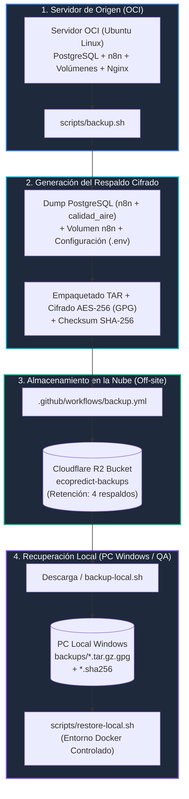

# MANUAL OFICIAL DE DISASTER RECOVERY: BACKUP Y RESTAURACIÓN LOCAL
## "EcoPredict & NLQ" — Sistema de Alerta e Investigación Ambiental Ciudadana
**Universidad de San Martín de Porres (USMP) — Facultad de Ingeniería y Arquitectura**  
**Curso:** Taller de Proyectos | **Docente:** Ing. Norma Birginia León Lescano  
**Responsables:** DevSecOps (Carlos Chávez / David Llamocca) & QA / Test Automation (Johann Romero)

---

## 📌 1. Arquitectura General de Disaster Recovery

El sistema de respaldo y recuperación ante desastres de *EcoPredict & NLQ* está diseñado bajo una estrategia híbrida y desacoplada que asegura la continuidad operativa, integridad criptográfica y almacenamiento fuera de sitio (*off-site*):



> ⚠️ **ADVERTENCIA DE SEGURIDAD OPERACIONAL (REGLA DE ORO):**  
> **NUNCA ejecutar la restauración sobre el servidor de producción en la nube (OCI)** durante las demostraciones académicas, ya que una restauración destructiva sobre el entorno en vivo eliminaría los datos transaccionales recientes y provocaría la interrupción de los servicios de n8n, Vercel y Telegram.  
> **Toda prueba y demostración de restauración se realiza de forma 100% LOCAL** en un entorno Docker controlado.

---

## 🚀 2. Las 4 Etapas del Ciclo de Vida del Respaldo

### 🔹 ETAPA 1: Generación del Respaldo en el Servidor (OCI)
El script [`scripts/backup.sh`](file:///C:/Users/johan/.gemini/antigravity/scratch/Grupo1_EcoPredict-NLQ/scripts/backup.sh) realiza las siguientes operaciones automáticas y atómicas:
1. **Validación de Integridad de Entrada**: Verifica la existencia de la clave de cifrado simétrico, el archivo `.env` protegido y el archivo `docker-compose.yml`.
2. **Inspección de Contenedores**: Comprueba que el contenedor `aire_postgres` y el volumen `aire_n8n_data` existan y estén activos.
3. **Pausa Preventiva de n8n**: Detiene momentáneamente el contenedor `aire_n8n` para garantizar consistencia transaccional (evitando escrituras intermedias mientras se respaldan las bases de datos).
4. **Extracción de Componentes**:
   * Base de datos `n8n` (formato binario comprimido `-Fc`).
   * Base de datos `calidad_aire` (con datos de sensores y series temporales SENAMHI).
   * Roles y privilegios globales de PostgreSQL (`globals.sql`).
   * Volumen persistente de n8n (`n8n-volume.tar.gz`).
   * Configuraciones de tiempo de ejecución (`runtime.env`, `docker-compose.yml`, reglas Nginx).
5. **Generación del Manifiesto**: Crea `manifest.txt` con versión `ecopredict-backup-v2` y marca de tiempo UTC.
6. **Cifrado Criptográfico**: Empaqueta todo en un archivo `.tar.gz` y lo cifra mediante **GnuPG con algoritmo AES-256** (modo S2K con hash SHA-512).
7. **Generación de Checksum**: Calcula el hash SHA-256 (`.sha256`) y realiza una prueba de descifrado en memoria para asegurar que el backup no esté corrupto antes de reiniciar n8n.

---

### 🔹 ETAPA 2: Almacenamiento en la Nube (Cloudflare R2)
El flujo automatizado en GitHub Actions [`.github/workflows/backup.yml`](file:///C:/Users/johan/.gemini/antigravity/scratch/Grupo1_EcoPredict-NLQ/.github/workflows/backup.yml) se ejecuta semanalmente de forma programada o manual:
1. Conexión segura vía SSH con OCI.
2. Ejecución remota de `backup.sh`.
3. Verificación de cuota de almacenamiento en Cloudflare R2.
4. Transferencia de los dos artefactos generados al bucket privado `ecopredict-backups`:
   * Archivo cifrado: `ecopredict-YYYYMMDDTHHMMSSZ.tar.gz.gpg`
   * Checksum de integridad: `ecopredict-YYYYMMDDTHHMMSSZ.tar.gz.gpg.sha256`
5. Aplicación automática de la **política de retención** (conserva únicamente los 4 respaldos más recientes para optimizar almacenamiento).

✅ **Evidencia de Respaldo Validado en R2 (07 de Noviembre de 2026):**
* **Nombre de Archivo:** `ecopredict-20261107T193835Z.tar.gz.gpg`
* **Tamaño:** `3.16 MB`
* **Hash SHA-256:** `ecopredict-20261107T193835Z.tar.gz.gpg.sha256`

---

### 🔹 ETAPA 3: Obtención del Backup Local en PC Windows
Para conservar una réplica exacta del respaldo de la nube en la máquina local:

```text
Grupo1_EcoPredict-NLQ/
└── backups/
    ├── ecopredict-20261107T193835Z.tar.gz.gpg
    └── ecopredict-20261107T193835Z.tar.gz.gpg.sha256
```

#### Opción A: Mediante el Script de Descarga (Requiere AWS CLI configurado con R2)
```bash
# Desde Git Bash en la raíz del proyecto:
bash scripts/backup-local.sh --from-r2
```

#### Opción B: Descarga Directa desde la Consola de Cloudflare R2 (Recomendada si no hay AWS CLI)
1. Acceder al dashboard de Cloudflare R2 con la cuenta del proyecto.
2. Navegar al bucket `ecopredict-backups`.
3. Descargar el archivo `.tar.gz.gpg` y su archivo `.sha256` correspondiente.
4. Colocar ambos archivos dentro de la carpeta `Grupo1_EcoPredict-NLQ/backups/`.
5. Validar la integridad del archivo descargado desde Git Bash:
   ```bash
   cd backups/
   sha256sum -c ecopredict-20261107T193835Z.tar.gz.gpg.sha256
   # Salida esperada: ecopredict-20261107T193835Z.tar.gz.gpg: OK
   ```

---

### 🔹 ETAPA 4: Proceso de Restauración Local Paso a Paso (RESTORE)

> 💡 **Enfoque de QA:** La restauración se ejecuta en el entorno local de Docker para verificar la capacidad de recuperación ante desastres sin poner en riesgo los servidores productivos.

#### Prerrequisitos en la Máquina Local:
* **Docker Desktop** instalado y en ejecución.
* **Git Bash** (incluye herramientas `gpg`, `tar`, `sha256sum`, `sed`, `awk`).
* Archivo de clave de descifrado local (e.g. `secret.key`).

#### Paso a Paso para Restaurar Localmente:

1. **Verificar que los contenedores locales de desarrollo estén encendidos:**
   ```bash
   docker compose -f infrastructure/docker-compose.yml ps
   ```

2. **Crear el archivo temporal de clave de descifrado (en memoria o temporal):**
   ```bash
   # Crear archivo con la frase de paso (passphrase) configurada para el respaldo:
   echo "TU_CLAVE_DE_CIFRADO" > /tmp/backup_key.txt
   chmod 600 /tmp/backup_key.txt
   ```

3. **Ejecutar el script de restauración local:**
   ```bash
   # Sintaxis: bash scripts/restore.sh --backup-file <RUTA_BACKUP> --key-file <RUTA_KEY> --confirm RESTORE
   bash scripts/restore.sh \
     --backup-file backups/ecopredict-20261107T193835Z.tar.gz.gpg \
     --key-file /tmp/backup_key.txt \
     --confirm RESTORE
   ```

4. **Mecanismo de Seguridad Integrado en el Script:**
   * **Validación de Checksum**: Si el archivo fue alterado o está incompleto, aborta antes de tocar nada.
   * **Copia de Seguridad Preventiva Automática (*Rollback Recovery*)**: Antes de borrar o modificar las bases de datos locales, el script genera un snapshot de seguridad en `backups/pre-restore/`. Si la restauración falla a mitad del proceso, restaura automáticamente el snapshot preventivo.
   * **Recreación de Bases de Datos**: Elimina y recrea `n8n` y `calidad_aire`, restaurando esquemas, tablas, índices y extensiones (`vector`).
   * **Restauración del Volumen de n8n**: Descomprime los workflows y credenciales con permisos numéricos limpios.
   * **Health Checks Automáticos**: Valida el estado `healthy` de PostgreSQL, n8n y Nginx en `/healthz/readiness`.

5. **Limpieza de credenciales temporales:**
   ```bash
   rm -f /tmp/backup_key.txt
   ```

---

## 🧠 3. DIFICULTADES Y RETOS TÉCNICOS DEL BACKUP (Para la Sustentación)

Durante la sustentación ante la docente **Ing. Norma León**, se debe exponer con claridad cuáles fueron los desafíos técnicos que el equipo enfrentó y resolvió:

1. **Consistencia Transaccional y Bloqueo de n8n**:
   * *Dificultad:* Realizar un dump con n8n encendido generaba inconsistencias si un webhook recibía datos en ese milisegundo.
   * *Solución:* El script pausa atómicamente el contenedor de n8n únicamente durante los segundos que dura el `pg_dump` y la compresión del volumen, reiniciándolo de inmediato mediante un `trap cleanup EXIT`.
2. **Cifrado Fuerte sin Exposición de Contraseñas (AES-256 + GPG)**:
   * *Dificultad:* Evitar que la clave de cifrado quede registrada en el historial de comandos de Bash (`history`) o en logs.
   * *Solución:* Se implementó paso por archivo `--passphrase-file` con permisos restringidos `0600` y modo loopback, asegurando cifrado simétrico robusto AES-256 con derivación de clave S2K/SHA-512.
3. **Manejo de Errores de API en Cloudflare R2 con JMESPath**:
   * *Dificultad:* Al consultar el tamaño de un bucket vacío o recién inicializado, el CLI de AWS arrojaba error de sintaxis porque `Contents` devolvía `null` en lugar de una lista.
   * *Solución:* Se corrigió la consulta JMESPath en el PR #275 para manejar valores nulos y evitar que el pipeline de GitHub Actions se detuviera.
4. **Prevención de Desastres durante el Restore (Rollback Recovery)**:
   * *Dificultad:* Si un backup corrupto se empezaba a restaurar, dejaba la base de datos a medio borrar y el sistema inutilizable.
   * *Solución:* Se diseñó un mecanismo de *Rollback Recovery* de dos fases: genera un snapshot preventivo obligatorio antes de borrar tablas y, si los *health checks* finales fallan, restaura automáticamente el estado anterior.
5. **Aislamiento de Entornos (Nube vs Local)**:
   * *Dificultad:* Riesgo de sobrescribir accidentalmente el servidor de producción al probar la restauración.
   * *Solución:* Política estricta de no ejecución de restores en OCI en vivo, canalizando toda la verificación y sustentación al entorno local controlado en Docker.

---

## 🧪 4. Verificación de Integridad de QA (Checklist Post-Restauración)

Para certificar que la restauración fue 100% exitosa, QA verifica los siguientes puntos:

| Componente | Comando de Verificación | Resultado Esperado |
| :--- | :--- | :--- |
| **Integridad del Hash** | `sha256sum -c backups/*.sha256` | `OK` (Sin discrepancia de bits) |
| **Contenedor Postgres** | `docker inspect -f '{{.State.Health.Status}}' aire_postgres` | `healthy` |
| **Base de Datos calidad_aire** | `docker exec -it aire_postgres psql -U n8n_user -d calidad_aire -c "\dt"` | Lista completa de tablas (`senamhi_historico`, `analytics_mv`) |
| **Extensión pgvector** | `docker exec -it aire_postgres psql -U n8n_user -d calidad_aire -c "SELECT * FROM pg_extension WHERE extname='vector';"` | Extensión `vector` instalada y activa |
| **Contenedor n8n** | `docker inspect -f '{{.State.Running}}' aire_n8n` | `true` |
| **Healthcheck n8n** | `curl -f http://127.0.0.1:5678/healthz/readiness` | HTTP 200 OK |

---

## 📹 5. Guion para el Video Demostrativo (Plan B de Contingencia)

Siguiendo la recomendación de la docente (*"no vaya a ser que ese día no se pueda, que las credenciales de la nube..."*), se debe tener un video de 3 minutos grabado:

1. **Minuto 0:00 - 0:45 (Introducción y Arquitectura):**
   * Mostrar el diagrama de arquitectura y explicar el flujo: OCI $\rightarrow$ Cifrado AES-256 $\rightarrow$ Cloudflare R2 $\rightarrow$ Restauración Local.
2. **Minuto 0:46 - 1:30 (Demostración de Descarga y Verificación SHA-256):**
   * Mostrar la carpeta `backups/` con el archivo `.tar.gz.gpg` y ejecutar `sha256sum -c *.sha256` demostrando integridad.
3. **Minuto 1:31 - 2:30 (Demostración de Restauración en Docker):**
   * Ejecutar el script `restore.sh` en Git Bash, mostrar la creación del snapshot preventivo y la restauración exitosa de las bases de datos.
4. **Minuto 2:31 - 3:00 (Verificación de Servicios y Cierre):**
   * Mostrar los contenedores saludables y una consulta SQL rápida en `aire_postgres` demostrando que los datos están intactos.
