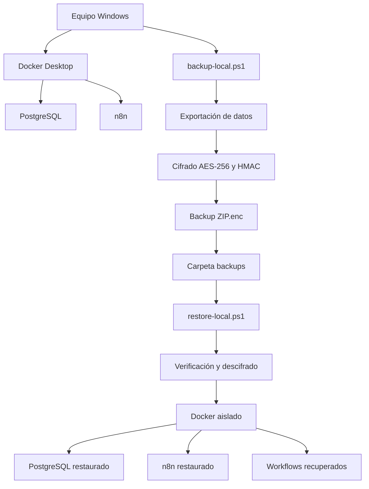
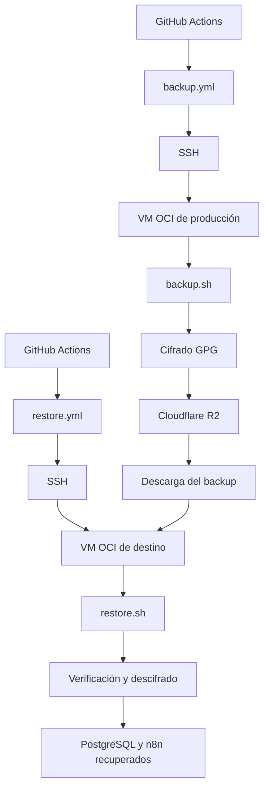
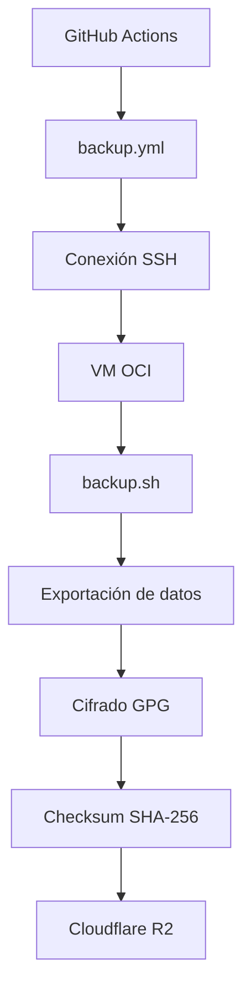
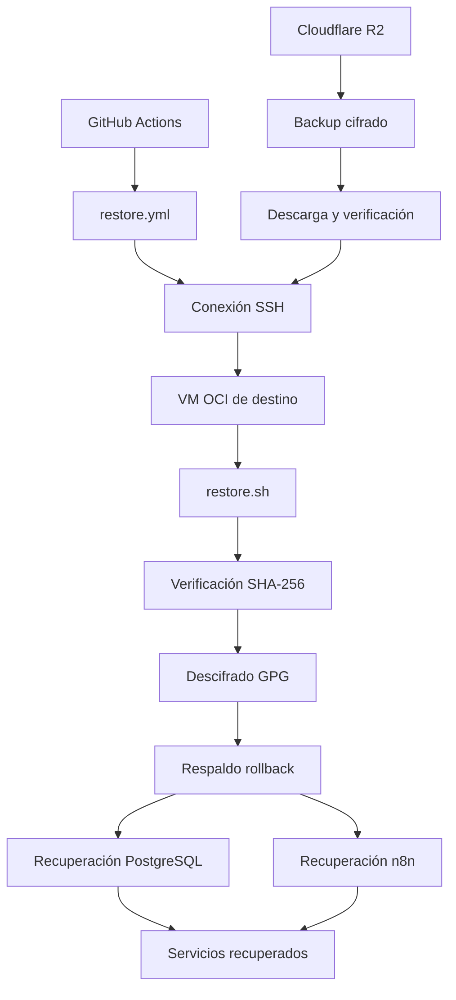

# EcoPredict & NLQ – Backup y Restore

**Área:** DevSecOps  
**Proyecto:** Sistema de Alerta e Investigación Ambiental Ciudadana

## 1. Introducción

Este documento describe los procedimientos de respaldo y recuperación de EcoPredict & NLQ en entornos locales y cloud.

Se contemplan cuatro procedimientos:

- Backup local.
- Restore local.
- Backup cloud (OCI → Cloudflare R2).
- Restore cloud (Cloudflare R2 → OCI).

El objetivo es que DevSecOps y QA puedan ejecutar los procedimientos de forma reproducible y comprobar que los datos y servicios puedan recuperarse.

## 2. Arquitectura general

### 2.1. Arquitectura local



### 2.2. Arquitectura cloud



> **Nota:** GitHub Actions coordina la ejecución de los procedimientos. No crea automáticamente una segunda VM OCI. Para las pruebas de QA se necesita una VM de destino independiente.

## 3. Organización de archivos

```text
Grupo1_EcoPredict-NLQ/
├── .github/
│   └── workflows/
│       ├── backup.yml
│       └── restore.yml
├── scripts/
│   ├── backup.sh
│   ├── restore.sh
│   ├── backup-local.ps1
│   ├── restore-local.ps1
│   ├── backup-local.sh
│   ├── restore-local.sh
│   └── Readme.md
├── infrastructure/
│   └── docker-compose.restore-local.yml
└── backups/
```

> **Nota:** esta estructura documenta las ubicaciones previstas. No mover scripts sin comprobar primero sus dependencias y referencias.

## 4. Seguridad

| Mecanismo      | Función                       |
| -------------- | ----------------------------- |
| GPG AES-256    | Cifrado del backup cloud      |
| AES-256-CBC    | Cifrado del backup local      |
| HMAC-SHA-256   | Autenticidad del backup local |
| SHA-256        | Integridad de los archivos    |
| GitHub Secrets | Protección de credenciales    |
| SSH            | Comunicación segura con OCI   |

### 4.1. Protección de credenciales

La clave local se almacena fuera del repositorio:

`C:\Secure\ecopredict-backup.key`


**Generación de clave universal en PowerShell (compatible con Windows PowerShell 5.1 y 7):**

`powershell
New-Item -ItemType Directory -Force -Path C:\Secure | Out-Null
 = [System.Security.Cryptography.RandomNumberGenerator]::Create()
 = New-Object byte[] 32; .GetBytes()
[IO.File]::WriteAllText('C:\Secure\ecopredict-backup.key', [Convert]::ToBase64String())
`

**Imagen auxiliar de empaquetado Docker:**
Los scripts de respaldo y recuperación utilizan \lpine:3.20\ para empaquetado consistente de volúmenes persistentes. Los scripts verifican su existencia y la descargan automáticamente si es necesario:
`powershell
docker pull alpine:3.20
`
Las credenciales cloud se configuran mediante GitHub Secrets.

No subir al repositorio:

- Claves privadas SSH.
- Claves de cifrado.
- Archivos `.env`.
- Credenciales de Cloudflare R2.
- Backups sin cifrar.
- Archivos temporales de restauración.

> **Advertencia:** nunca mostrar secretos en logs, capturas de pantalla o documentación.

---

# 5. BACKUP LOCAL

## 5.1. Descripción

Genera un respaldo cifrado desde el equipo Windows utilizando:

`scripts/backup-local.ps1`

## 5.2. Requisitos

- Windows y PowerShell.
- Docker Desktop funcionando.
- Repositorio EcoPredict & NLQ.
- Clave de cifrado local.

## 5.3. Procedimiento

**Paso 1.** Abrir PowerShell y ubicarse en la raíz del repositorio:

```powershell
cd C:\Users\OS\Desktop\Taller\EcoPredict-NLQ\Grupo1_EcoPredict-NLQ
```

**Paso 2.** Ejecutar el backup:

```powershell
powershell.exe -ExecutionPolicy Bypass -File .\scripts\backup-local.ps1 -KeyFile C:\Secure\ecopredict-backup.key
```

**Paso 3.** Esperar la finalización y revisar los archivos:

```powershell
Get-ChildItem .\backups\
```

## 5.4. Resultado esperado

Se generan:

- Archivo cifrado `.zip.enc`.
- Archivo de checksum `.sha256`.

Ejemplo:

```text
backups/
├── ecopredict-local-20261108T192827Z.zip.enc
└── ecopredict-local-20261108T192827Z.zip.enc.sha256
```

El contenido contempla bases de datos PostgreSQL, datos persistentes de n8n, archivos JSON de workflows y configuración protegida necesaria para la recuperación.

---

# 6. RESTORE LOCAL

## 6.1. Descripción

Recupera un backup local en recursos Docker aislados, sin modificar los contenedores originales.

Script:

`scripts/restore-local.ps1`

## 6.2. Requisitos

- Windows y PowerShell.
- Docker Desktop funcionando.
- Repositorio del proyecto.
- Backup `.zip.enc` y checksum `.sha256`.
- Clave de cifrado correspondiente.

## 6.3. Procedimiento

**Paso 1.** Ubicarse en el repositorio:

```powershell
cd C:\Users\OS\Desktop\Taller\EcoPredict-NLQ\Grupo1_EcoPredict-NLQ
```

**Paso 2.** Identificar el backup:

```powershell
Get-ChildItem .\backups\
```

**Paso 3.** Ejecutar el Restore:

```powershell
powershell.exe -ExecutionPolicy Bypass -File .\scripts\restore-local.ps1 -BackupFile .\backups\ecopredict-local-<fecha>.zip.enc -KeyFile C:\Secure\ecopredict-backup.key
```

Reemplazar `<fecha>` por el nombre real del archivo.

## 6.4. Recursos de recuperación

| Recurso            | Nombre                             |
| ------------------ | ---------------------------------- |
| PostgreSQL         | `ecopredict_restore_postgres`      |
| n8n                | `ecopredict_restore_n8n`           |
| Nginx              | `ecopredict_restore_nginx`         |
| Red                | `ecopredict_restore_network`       |
| Volumen PostgreSQL | `ecopredict_restore_postgres_data` |
| Volumen n8n        | `ecopredict_restore_n8n_data`      |
| Volumen workflows  | `ecopredict_restore_workflows`     |

## 6.5. Verificación

Comprobar los contenedores:

```powershell
docker ps
```

Comprobar n8n:

```powershell
curl.exe -I http://localhost:15678/healthz/readiness
```

Comprobar Nginx:

```powershell
curl.exe -I http://localhost:18080
```

Comprobar los archivos de workflows:

```powershell
docker exec ecopredict_restore_n8n sh -c "ls /workflows/production"
```

Verificar también la existencia de las bases de datos y sus tablas.

> **Nota:** los archivos JSON recuperados en `/workflows/production` no se importan automáticamente como workflows registrados en la interfaz de n8n. Se recuperan como archivos.

---

# 7. BACKUP CLOUD – OCI A CLOUDFLARE R2

## 7.1. Descripción

El backup cloud permite generar un respaldo desde la VM OCI y almacenarlo cifrado en Cloudflare R2.

Workflow:

`.github/workflows/backup.yml`

Script:

`scripts/backup.sh`

## 7.2. Arquitectura



## 7.3. Requisitos

- VM OCI operativa.
- Docker y Docker Compose.
- Repositorio actualizado.
- Bucket Cloudflare R2.
- Credenciales SSH.
- Credenciales S3 compatibles de R2.
- Clave de cifrado.

## 7.4. Configuración de GitHub

El workflow utiliza secretos y variables configurados en:

**GitHub → Settings → Secrets and variables → Actions**

Entre los datos necesarios se encuentran:

- Acceso SSH a la VM OCI.
- Credenciales de Cloudflare R2.
- Endpoint del bucket.
- Nombre del bucket.
- Clave de cifrado.

Los nombres exactos deben coincidir con las referencias del workflow.

Bucket utilizado:

`ecopredict-backups`

## 7.5. Ejecución

**Paso 1.** Ingresar al repositorio GitHub.

**Paso 2.** Abrir la pestaña Actions.

**Paso 3.** Seleccionar el workflow `Backup OCI to Cloudflare R2`.

**Paso 4.** Ejecutar `Run workflow`.

**Paso 5.** Esperar que finalicen los trabajos.

**Paso 6.** Comprobar que el workflow termine correctamente.

**Paso 7.** Ingresar al bucket R2 y verificar que existan:

- Archivo de backup cifrado `.tar.gz.gpg`.
- Archivo de checksum `.sha256`.

## 7.6. Programación automática

El workflow dispone de una programación semanal:

```yaml
schedule:
  - cron: "17 3 * * 0"
```

Esto corresponde al domingo a las 03:17 UTC.

> **Nota:** el workflow también permite ejecución manual desde GitHub Actions.

## 7.7. Control de almacenamiento

Se ha configurado un límite preventivo de 9 GiB para evitar superar la capacidad prevista del almacenamiento.

Este control preventivo no equivale a una garantía de facturación máxima de Cloudflare. Se recomienda revisar el uso del bucket periódicamente.

---

# 8. RESTORE CLOUD – CLOUDFLARE R2 A OCI

## 8.1. Descripción

El Restore cloud permite recuperar el backup cifrado almacenado en R2 y restaurarlo en una VM OCI.

Se dispone de dos componentes:

- Workflow: `.github/workflows/restore.yml`.
- Script: `scripts/restore.sh`.

El workflow coordina la ejecución mediante GitHub Actions y SSH. El script realiza las operaciones de recuperación en la VM de destino.

## 8.2. Arquitectura



## 8.3. Requisitos

- Segunda VM OCI independiente de producción.
- Ubuntu 22.04.
- Docker y Docker Compose.
- Repositorio del proyecto.
- Acceso a Cloudflare R2.
- Credenciales S3 compatibles.
- Backup cifrado y checksum.
- Clave GPG correspondiente.
- Variables de entorno y configuración requeridas.
- Espacio suficiente para la recuperación.

## 8.4. ¿Por qué se necesita una segunda VM?

El Restore puede modificar o sobrescribir datos del entorno de destino.

Por seguridad, QA debe utilizar una VM independiente para comprobar la recuperación sin afectar la instancia productiva.

**Importante:**

- El workflow no crea automáticamente una segunda VM.
- El destino depende de la configuración SSH de `restore.yml`.
- La VM de pruebas debe existir y estar preparada antes de iniciar el workflow.
- No se deben utilizar credenciales de producción para realizar pruebas destructivas.

## 8.5. Configurar el destino de GitHub Actions

En GitHub:

1. Ingresar a Settings.
2. Abrir Secrets and variables.
3. Seleccionar Actions.
4. Revisar los secretos SSH utilizados por `restore.yml`.
5. Configurar el acceso a la VM de pruebas de acuerdo con los nombres de secretos que utilice el workflow.

Si el backup y el restore comparten credenciales SSH, no se deben modificar indiscriminadamente. Es necesario revisar primero las referencias del YAML y separar los destinos cuando corresponda.

## 8.6. Procedimiento automatizado mediante GitHub Actions

**Paso 1.** Verificar que la segunda VM esté disponible.

**Paso 2.** Comprobar que Docker, Docker Compose y la configuración requerida estén preparados.

**Paso 3.** Verificar el acceso a Cloudflare R2.

**Paso 4.** Confirmar que el workflow esté configurado para conectarse a la segunda VM.

**Paso 5.** Ingresar a GitHub → Actions.

**Paso 6.** Seleccionar el workflow de Restore definido en `restore.yml`.

**Paso 7.** Ejecutar el workflow manualmente.

**Paso 8.** Revisar los logs y comprobar que la recuperación termine correctamente.

> **Nota:** los nombres de los inputs y los pasos exactos de `workflow_dispatch` deben corresponder al contenido real de `restore.yml`. No asumir parámetros que no estén definidos en el YAML.

## 8.7. Procedimiento manual mediante script

Si se ejecuta directamente desde la VM de pruebas, el procedimiento documentado para `restore.sh` es:

```bash
bash scripts/restore.sh \
  --backup-file <archivo>.tar.gz.gpg \
  --key-file <ruta-segura-de-la-clave> \
  --confirm RESTORE
```

Este comando debe ejecutarse en la VM de destino y requiere que el backup y la clave estén disponibles en las rutas indicadas.

Antes de utilizarlo, verificar la configuración real de Compose y del entorno en esa VM.

## 8.8. Verificación

Comprobar los contenedores:

```bash
docker ps
```

Comprobar los servicios:

```bash
docker compose ps
```

Verificar:

- PostgreSQL inicia correctamente.
- Las bases de datos están disponibles.
- Las tablas y los datos fueron recuperados.
- n8n inicia correctamente.
- Los archivos de workflows están presentes.
- Nginx responde correctamente.
- No existen errores críticos en los logs.

Registrar capturas y logs como evidencia, sin exponer credenciales.

> **Advertencia:** el parámetro `--confirm RESTORE` autoriza una operación destructiva sobre el entorno de destino. No ejecutar sobre producción durante las pruebas de QA.

---

# 9. RECUPERACIÓN ANTE UNA EJECUCIÓN LOCAL INTERRUMPIDA

Existe un modo auxiliar de recuperación mediante `-ExtractEnvOnly`.

Este modo verifica el backup y extrae únicamente `restore.env` a una ubicación temporal protegida.

Ejemplo:

```powershell
powershell.exe -ExecutionPolicy Bypass -File .\scripts\restore-local.ps1 `
  -BackupFile .\backups\ecopredict-local-<fecha>.zip.enc `
  -KeyFile C:\Secure\ecopredict-backup.key `
  -ExtractEnvOnly
```

Si PostgreSQL ya fue recuperado y únicamente falta iniciar n8n y Nginx:

```powershell
docker compose --project-name ecopredict_restore `
  --env-file "$env:TEMP\ecopredict-restore.env" `
  -f .\infrastructure\docker-compose.restore-local.yml `
  up -d --no-deps --pull never n8n nginx
```

> **Nota:** este procedimiento es auxiliar y no sustituye al Restore local normal. No debe confundirse con una restauración completa.

---

# 12. CONSIDERACIONES FINALES

Los mecanismos de Backup y Restore permiten proteger los datos de EcoPredict & NLQ y recuperar sus componentes ante una pérdida o interrupción del entorno.

La existencia de un backup no garantiza por sí sola que la recuperación sea exitosa. Por ello, QA debe comprobar que los datos puedan restaurarse y que los servicios vuelvan a funcionar.

El equipo DevSecOps debe conservar las evidencias de ejecución, documentar las incidencias y corregir los problemas encontrados antes de la demostración final.

**Responsable:** DevSecOps  
**Validación:** QA  
**Proyecto:** EcoPredict & NLQ
